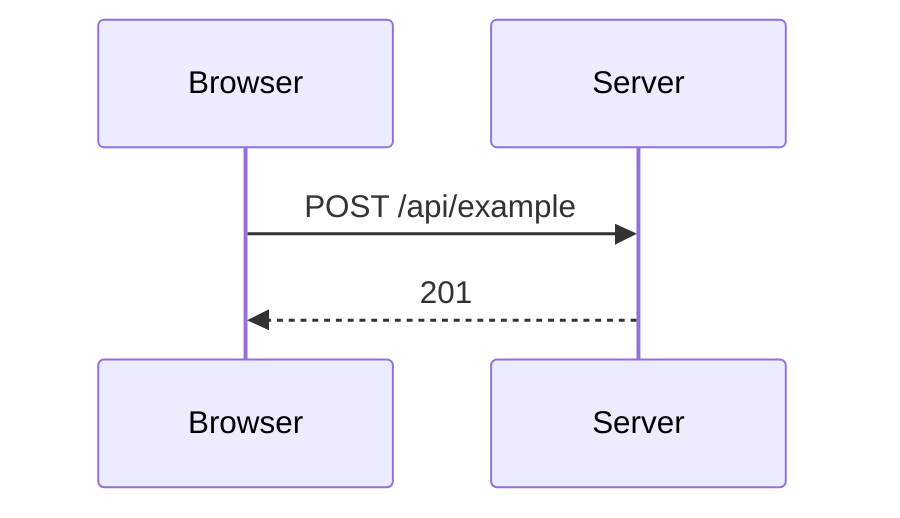

<!--
Delete the sections that do not apply. Title and body in English, Conventional Commits in the title.
Base branch is always `staging`; merge by rebase. Visual change = screenshots below, always. Behavior, data or flow change = skeleton + diagram when it clarifies.
-->

## Why

<!-- The problem or the decision behind this. Link the SPEC or ADR if there is one. -->

## What changes

<!-- Short bullets, by effect (not by file). -->

## Visual changes

<!--
REQUIRED when anything the user sees changes. Delete this section only for non-visual PRs.
- Before and after when an existing screen changes; only "after" for a new screen.
- Desktop and mobile. Light and dark when the change touches the theme.
- The states that matter: empty, loading, error, full.
- Fake data only (the repo is public): no real e-mail, token, customer or person.
- Upload with `scripts/pr-assets.sh <folder> <png>...` and paste the markdown it prints.

| Before | After |
| --- | --- |
|  |  |
-->

## Flow, data or architecture

<!--
For a change in behavior, data or how pieces talk to each other. One small diagram (up to about 10 nodes), only if it clarifies. GitHub renders Mermaid:

- steps between systems or people (auth, webhooks, jobs, invitations): sequenceDiagram
- decision rules: flowchart TD
- states of a record (invitation, post, account): stateDiagram-v2
- new or changed tables: erDiagram, only the touched tables, plus a table of the new constraints
- routes: table with Route | Permission | Request | Responses
- config: table with Variable | Where it is set | Default
- behavior that changed without a diagram: Before | After table

-->

## Verification

<!-- What was actually exercised (tests, a real browser, a real database) and what was NOT. Be explicit about the second part. -->

## Risk and rollback

<!-- What can break, who notices, how to undo (revert, flag, migration is additive). Delete if trivial. -->
