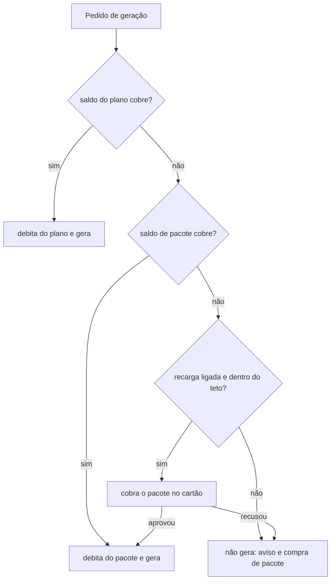

# ADR 0029: assinatura com créditos e recarga automática em pacotes, no lugar do pós-pago por consumo

- **Status:** proposto; direção aprovada pelo Matheus em 29/10/2026, valores e pontos abertos ao fim
- **Data:** 2026-10-29
- **Cards:** BEZ-489 (decisão), BEZ-301 (cobrança real), BEZ-135 (cobrança, pai)
- **Substitui em parte:** [ADR 0023](0023-cobranca-por-consumo-com-cartao-obrigatorio.md) (decisões 1, 4 e 5). Mantém as
  decisões 3 (cartão obrigatório) e 6 (cartão pertence à conta). A 2 (taxa por pessoa e por marca) virou os quatro planos da SPEC 021.
- **Specs que dependem:** [SPEC 021](../specs/021-planos-e-cobranca-por-consumo.md) (regras), [SPEC 031](../specs/031-fatura-e-uso.md)
  (a tela), [SPEC 032](../specs/032-preco-por-conta.md) (desconto por conta)

## Contexto

A ADR 0023 escolheu cobrar depois do uso, sem mensalidade, com alerta de gasto que não bloqueia. Duas coisas pesaram contra manter isso:

1. **O custo de um post varia por ordem de grandeza.** Pela [análise de custo e preço por post](../analises/2026-10-28-custo-e-preco-por-post.md),
   de cerca de R$ 0,01 (motor rápido, sem imagem de IA) a R$ 3,90 (autoral com imagem Pro). Uma unidade única "post" não serve para vender
   isso; uma moeda interna com peso por tipo e nível serve.
2. **O pós-pago aberto deixa a BEZ pagar primeiro.** O custo acontece antes da cobrança, o alerta não trava nada e a única defesa contra
   calote é o cartão cadastrado. Quem usa muito e não paga custa dinheiro.

A Runway (plataforma de criação de mídia) trabalha assim: mensalidade com créditos, cada geração debita créditos conforme o modelo, crédito
comprado à parte não vence e o do plano zera no ciclo. As páginas dela não mostram recarga automática nem política de estorno; aqui as duas
fazem parte da decisão.

## Decisão

1. **Assinatura mensal com créditos incluídos.** O crédito é a unidade de consumo. Cada item gerado debita créditos conforme uma tabela por
   tipo de item e nível de qualidade. **Tudo que custa token ou dinheiro à BEZ debita**: gerar, regenerar, ajuste,
   avaliar de novo, tentar de novo a rede e a publicação no X. O peso vem do custo medido e o que não tem custo mensurável pesa zero.
2. **Dois preços do crédito, sem crédito avulso fora do plano:** o do plano (mais barato) e o do pacote de recarga, de **10% a 25% mais caro**
   que o do plano. Só quem tem plano compra pacote.
3. **Validade.** O saldo do plano **vence no fim do ciclo e não acumula**. O saldo de pacote **não vence e não tem reembolso**: é usado até
   acabar. A geração consome primeiro o saldo do plano e depois o do pacote.
4. **Recarga automática em pacotes, cobrada antes do uso.** O administrador liga ou desliga, escolhe o pacote e define um **teto mensal de
   recarga**. Quando o saldo não cobre a geração, a Ekoai cobra o pacote no cartão e só então libera. Se a cobrança falhar, a recarga estiver
   desligada ou o teto for atingido, a geração não começa e a tela leva a comprar. **A BEZ nunca gera sem ter recebido.**
5. **Estorno automático em falha técnica** (erro nosso, modelo fora do ar, geração que não terminou). Insatisfação com o resultado não devolve
   crédito.
6. **Primeiro post grátis por conta**, com cartão válido já cadastrado (exceção ao "sem franquia grátis" da ADR 0023), para a pessoa testar a
   qualidade.
7. **Cartão obrigatório e papéis seguem como na ADR 0023.** O preço de cada plano e a taxa de R$ 10 por pessoa a mais estão na SPEC 021. Pix para o pacote avulso depende do gateway
   (SPEC 021, pergunta aberta).
8. **Mensalidade recusada:** novas tentativas na carência e, depois dela, a conta fica somente leitura (ver, exportar, trocar o cartão),
   como na ADR 0023. Nunca se apaga dado por falta de pagamento.

## Consequências

- **O calote cai e some do consumo.** Mensalidade e pacote entram antes do uso. Sobram a mensalidade recusada e a contestação no cartão.
- **Quem paga o erro do modelo é o cliente**, porque toda geração debita, aprovada ou não. O estorno cobre só falha técnica. Vale reavaliar
  com dado de produção: se a taxa de reprovação for alta, a regra pesa na confiança do usuário.
- **A tabela de créditos precisa do custo real.** Os pesos saem do custo medido por tipo e nível (Console › Financeiro, BEZ-260 e a análise
  de 28/10). Sem esse número, não há tabela nem preço do crédito.
- **Decisão de 28/10/2026 mantida** ("nenhuma tela do fluxo de post mostra custo"): o Matheus decidiu em 29/10/2026 que o saldo aparece só
  em Configurações › Fatura e uso. Fluxo de post e conexão não mostram custo nem saldo; os avisos de saldo vão por e-mail e dentro do app.
- **SPEC 031 ajustada:** ajuste, aplicar sugestão, avaliar de novo e tentar de novo a rede passam a debitar crédito (antes "não geravam
  cobrança"), porque cada um chama o modelo.
- **SPEC 032:** o desconto por conta passa a valer sobre o preço do crédito (ou créditos bônus), sem aparecer ao cliente.
- **SPEC 031, entrega 4:** vira saldo, pacotes, recarga e fatura da mensalidade, em vez de gasto do mês em reais.
- **Risco jurídico:** a regra do produto é pacote sem reembolso, usado dentro da plataforma. A lei de defesa do consumidor dá direito de
  arrependimento de 7 dias em compra online, o que pode valer para conta de pessoa física (empresa é outro caso). Validar com a advogada
  como escrever o termo antes de publicar.
- **A LP (ekoai-website #9) fica desatualizada:** ela mostra Individual a R$ 0 e preço por post. Ajustar quando os valores fecharem.

## Em aberto

Valores das mensalidades, dos créditos incluídos e do preço do crédito; pesos da tabela; percentual exato do pacote dentro da faixa de 10%
a 25%; tamanho dos pacotes e do teto padrão de recarga; crédito bônus para quem convida; gateway e Pix. Todos listados na SPEC 021.
