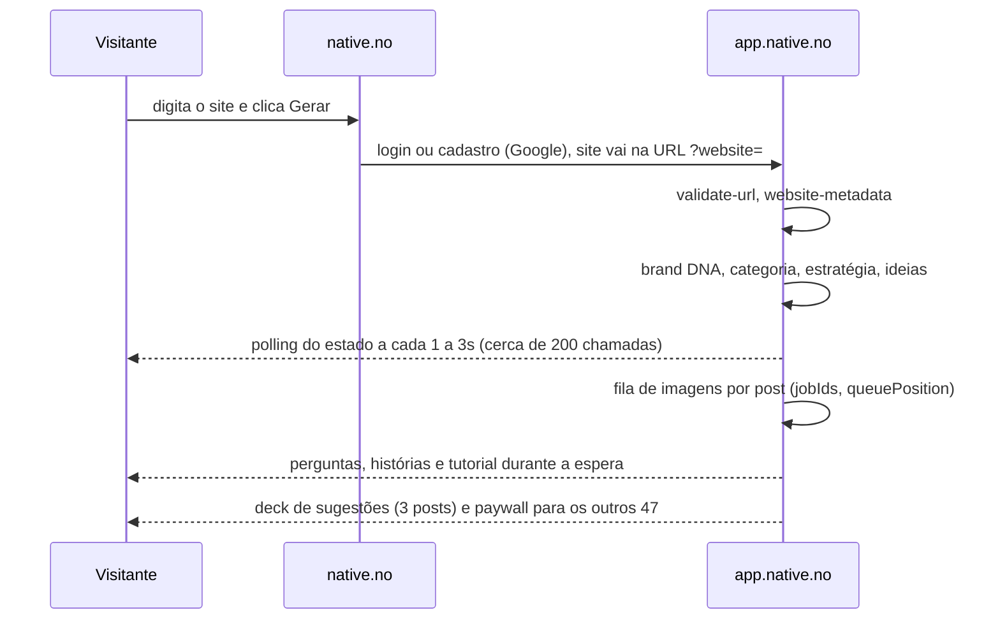

# Native (native.no): engenharia reversa do fluxo "cole seu site"

Concorrente direto. Análise de 03/11/2026 feita de fora: site público, blog, paper "Taste Layer" e uma
conta gratuita criada com o site da Ekoai como entrada. Só o que o navegador e a API do próprio cliente
mostram. Não pagamos, então Designer, volume de 50 posts e anúncios ficaram fora do teste.

## Linha do tempo medida (3 posts, 1 página de site)

| Marco | Horário | Desde o clique |
|---|---|---|
| Clique em "Generate" (já logado) | 12:53:10 | 0s |
| Brand DNA pronto (cores, fontes, logo, estilo) | 12:53:44 | 34s |
| Estratégia e 3 ideias prontas (engine `director`) | 12:55:50 | 160s (126s só nessa etapa) |
| Imagens (1 carrossel de 6 + 2 posts, em paralelo) | 12:55:53 a 12:56:10 | 17s |
| Estado `COMPLETED` | 12:56:11 | 3min01s |

A imagem é a etapa mais rápida. O que atrasa é a etapa de estratégia antes dela, e ela nem começa a gerar
imagem antes de terminar.

## Como o fluxo é montado

- **Login antes da geração.** O site digitado sobrevive ao cadastro pela URL (`/onboarding?website=`).
- **Um registro de onboarding** (`/api/onboarding-v2/<id>`, GET por polling e PATCH) guarda cada etapa em
  campos próprios: `websiteMetadata`, `websiteQuickExtract`, `websiteDeepCrawlV2`, `categoryClassification`,
  `brandDnaData`, `socialLook`, `strategyData`, `seedsData`, `posts`, `imageGenerationProgress`, mais um
  `...InProgress` por etapa e `reap-if-stuck` para destravar.
- **Leitura do site** devolve um JSON de marca no formato do `branding` do Firecrawl (cores, fontes,
  espaçamento, componentes, tipografia, personalidade). Inferência pelo formato, não confirmada.
- **Brand DNA** vem de IA em cima disso: `styleType`, papéis de fonte, regras, `moodTags`, `aestheticTags`,
  `styleReferences`, posição do logo, `colorSchemeType`, e um marcador `screenshotUsable` (usa captura da
  página). Para a Ekoai acertou Sora, coral `#FF8A65` e ameixa `#22122B`.
- **Ideias (seeds)** são objetos separados do post: `hook`, `type` (11 tipos, ex.: expert-tips,
  this-or-that, contrarian), `angle`, `format`, `platforms`, `readiness`, `dataScore`, `directorConcept`,
  `imageDescription` e `evidence` com `source: BRAND_FACT` e o trecho do site que sustenta a afirmação.
- **Imagens**: um job por post, o carrossel tem `totalImages: 6`, com `generationId`, `queuePosition` e
  `estimatedWaitMs`. O arquivo final fica em um bucket do Google Cloud Storage. Modelo de imagem: não
  identificado (roda no servidor).
- **Estado do app**: tRPC (`progression.*`, `onboarding.platform.*`) e REST. Analytics com PostHog (UE).
- **Paywall depois do valor**: 3 posts de graça e 15 tokens, "47+ posts" borrados no checkout. Pro US$ 79
  por mês (US$ 63 no anual, já marcado), Max US$ 249.

## O que a Native esconde ou exagera

- Prometem "50 posts"; o onboarding gera 3. Os outros 47 estão atrás do plano.
- Espera de 3 minutos mascarada por cerca de 10 perguntas de perfil, 8 telas narrativas e um tutorial de swipe que usa
  posts de demonstração da própria Native (paisagem, caiaque), nada da marca do cliente.
- `websitePagesCrawled: 1`, `researchSources: []`, `targetAudience: "General audience"`,
  `confidence: "medium"`: a estratégia saiu de uma página só. A saída ficou boa por causa do fingerprint,
  não da pesquisa.
- O logo da Ekoai entrou como preto, sem adaptar ao fundo.

## Qualidade da saída (carrossel da Ekoai)

Boa. Seis slides com o mesmo motivo (círculos concêntricos e gotas), Sora em peso alto, uma palavra em
coral, logo no canto, texto legível e sem corte no editor. Em LinkedIn a prévia em mosaico corta o título do
primeiro slide; no editor ele aparece inteiro.

## Decisões para a Ekoai (03/11/2026)

A Native gera 3 posts de uma vez e por isso espera a estratégia inteira antes da primeira imagem. A Ekoai gera
post por demanda, então "gerar a imagem de cada ideia ao ficar pronta" não se aplica ao nosso fluxo e foi
descartado. O ganho de percepção de tempo vem de mostrar resultado cedo, não de paralelizar imagens.

O onboarding que queremos (site e Instagram no cadastro, a Ekoai lê e mostra cores, tipo de marca e logo) **já
existe** no wizard de perfil (BEZ-525, BEZ-528): a pessoa informa o site e o @ do Instagram, a Ekoai lê a página
inicial, até 3 folhas de estilo e até 3 páginas internas (sobre, produtos, encomenda, contato), e mostra uma
tela de confirmação com negócio, jeito de falar, diferenciais, fatos como rascunho, logo, cores e fontes.
Lacunas em relação ao que queremos:

| Hoje | Queremos |
|---|---|
| Home mais 3 páginas escolhidas pelos links da própria página; sem sitemap | Ler o site inteiro: sitemap, blog, produtos |
| Uma requisição só com "Lendo o seu site" e tempo limite de 25s | Leitura por etapas na tela em até 30s: cores e logo primeiro, depois textos e tipo de marca |
| @ do Instagram só é guardado; legendas ajudam depois de conectar a conta | Definir o que dá para ler do Instagram sem conectar (ver pergunta aberta) |
| Progresso sem eventos | Progresso por evento (SSE ou Realtime), com granularidade por etapa |

Mantido: o campo "cole seu site" na landing, com o endereço preservado até o cadastro.

Pergunta aberta: ler o Instagram de uma conta pública sem conexão OAuth esbarra nos termos da Meta; o caminho
seguro é pedir a conexão no onboarding. A decidir.

## Medição da leitura da Ekoai em staging (03/11/2026, BEZ-537)

Uma leitura real de `native.no` (sitemap grande, 12 páginas lidas, Instagram conectado com 1 legenda), pelo endereço `run.app` do staging, com o log
"tempo por etapa" do BEZ-532:

| Etapa | Tempo |
|---|---|
| Abrir o site (robots.txt e página inicial) | 2,4 s |
| Mapa do site | 2,0 s |
| 12 páginas, 4 por vez (1,3 a 1,8 s cada) | cerca de 5 s no total |
| Modelo de texto | 4,7 s |
| **Total da leitura** | **13,7 s** (a requisição do stream respondeu 200 em 13,8 s) |

Leitura: com 12 páginas o total fica em um quarto do limite de 60 s da rota, então os limites do BEZ-534 (12 páginas, 4 por vez, 4000 caracteres)
ficam como estão. O gargalo é abrir o site e o modelo, não as páginas. O stream funcionou pelo Cloud Run. **Não testado:** o caminho pelo Firebase
Hosting (o domínio do app), que pode segurar ou cortar o fluxo. Dois defeitos achados na tela e corrigidos: a marca (logo e cores) só aparecia depois das
páginas, e a linha "Abrindo" saía duas vezes no histórico.

## Limites desta análise

Sem pagamento: não vimos o Designer em camadas, a geração sob demanda (Create), anúncios, agenda nem
analytics. O modelo de imagem e o motor de ideias (Norn) são inferências do material público. Conta de
teste criada com o Google da BEZ; apagar a conta quando não for mais necessária.
