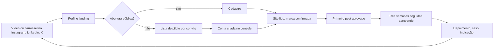

# Plano de marketing de 90 dias

> Proposta de 05/11/2026. Semana 1 começa em 09/11/2026 e a semana 12 termina em 31/01/2027. Posicionamento em
> [01-posicionamento.md](01-posicionamento.md). Metas são hipóteses até a semana 4.

## 1. Objetivo

Sair de zero presença para um funil que gera conversas com donos de negócio e primeiros clientes, usando o que a
Ekoai já tem (foto, carrossel, 4 vídeos) e o próprio produto para produzir o conteúdo.

| Etapa | Pergunta | Meta de 90 dias (hipótese) |
| --- | --- | --- |
| Descoberta | Quem viu? | 3 peças por semana nas 3 redes, 36 peças no total |
| Interesse | Quem veio ao perfil e à landing? | 500 seguidores no Instagram, 300 no LinkedIn, 200 no X, todos do público certo |
| Conversa | Quem falou com a gente? | 40 conversas (DM, comentário com intenção, e-mail) |
| Teste | Quem testou com a própria marca? | 15 pilotos |
| Ativação | Quem aprovou o primeiro post em 7 dias? | 10 das 15 contas |
| Receita | Quem pagou? | 5 contas pagantes (depende de D1 e D2) |

**North star de marketing:** contas com primeiro post aprovado em até 7 dias depois do cadastro. É a métrica que
une o conteúdo ao produto.

## 2. O funil na prática

## 3. Canais

| Canal | Papel | Cadência | Formato líder | Quem fala |
| --- | --- | --- | --- | --- |
| Instagram `@ekoai.app` | Vitrine, prova e DM | 3 posts por semana (1 Reel, 1 carrossel, 1 imagem) e stories quando houver demo | Carrossel e Reels | Marca |
| LinkedIn | Autoridade, agências, B2B | 3 posts por semana (1 vídeo ou PDF, 1 texto, 1 prova) | Documento (carrossel em PDF) e texto com gancho | Perfil do Matheus primeiro, página da Ekoai depois (SPEC 005) |
| X | Credibilidade técnica e build in public | 1 post por dia útil e 1 thread por semana | Texto curto, thread, clipe de 20 s | Perfil do Matheus e conta da Ekoai |

Regras por rede, tiradas da análise de algoritmos:

- **Instagram:** pensar em "quem manda isso para quem". Carrossel e Reels acima de imagem única. Palavra do cliente
  (ramo e cidade) na legenda e no texto alternativo. Não repostar sem transformar.
- **LinkedIn:** o gancho fica antes do corte do "ver mais". Terminar com pergunta que um colega de profissão responde
  com a experiência dele. Autor responde nas primeiras horas. Sem comentário em massa nem pod.
- **X:** cada post se sustenta sozinho (post com mais de 48 horas sai da disputa). Não postar três seguidos esperando
  alcance triplo. Responder de volta rápido é a ação que mais pesa. Link no post parece sem penalidade hoje, mas
  o custo de API existe.

## 4. Pilares de conteúdo

| Pilar | Peso | O que entra | Exemplo |
| --- | --- | --- | --- |
| Dor e rotina | 30% | Dica e provocação sobre Instagram de negócio local | "Quanto custa um Instagram parado?" |
| Demonstração | 25% | Takes do produto em 15 a 45 segundos | Vídeos 1, 3 e 4 |
| Bastidor técnico | 20% | Como o estúdio, o revisor e os fatos funcionam | Thread: como 8 agentes fazem 1 post |
| Prova | 15% | Antes e depois, caso do piloto, número real | Post de cliente piloto, com autorização |
| Visão | 10% | Por que existe, decisões, erros | Texto do fundador |

## 5. Quatro fases

| Fase | Semanas | Datas | Foco | Saída |
| --- | --- | --- | --- | --- |
| 0. Preparar | antes da 1 | 05 a 08/11 | Perfis, conta da Ekoai na Ekoai, banco de fatos | Pronto para publicar na segunda |
| 1. Apresentar | 1 a 4 | 09/11 a 06/12 | Quem é a Ekoai, a dor, a marca lida, fato com validade | Primeiros seguidores e 10 conversas |
| 2. Mostrar | 5 a 8 | 07/12 a 03/01 | Estúdio, aprovação, campanhas, aprendizado. Foco no LinkedIn para agências | Pilotos em andamento |
| 3. Provar e abrir | 9 a 12 | 04/01 a 31/01 | Casos, comparativo honesto, oferta e abertura | Primeiros pagantes |

A Meta deve responder entre 20 e 25/11 (semana 3). Se aprovar, a abertura pública pode adiantar. Se reprovar uma
permissão, a fase 1 continua e o piloto segue só com contas que têm papel no app.

## 6. Rotina semanal (cerca de 4 horas)

| Dia | O que | Tempo |
| --- | --- | --- |
| Segunda | Ler o calendário, gerar as 3 peças na Ekoai com os prompts, aprovar | 90 min |
| Terça a sábado | Publicar o que está agendado. Responder comentário e DM em até 2 horas no horário comercial | 15 min por dia |
| Quinta | Peça de vídeo ou carrossel novo, se faltar | 60 min |
| Sexta | 30 minutos de métricas e ajuste do calendário | 30 min |

A Ekoai gera e agenda o Instagram. LinkedIn e X ficam manuais (texto dos prompts) até saírem do "fora do menu".

## 7. Medição

| Métrica | Onde ver | Frequência | Para decidir o quê |
| --- | --- | --- | --- |
| Alcance, salvamentos, envios por post | Publicados e Analytics da própria Ekoai (Instagram) | Sexta | Qual hook e qual formato repetir |
| Seguidores novos e visitas ao perfil | Insights do Instagram, LinkedIn, X | Sexta | Se o canal merece o tempo |
| Cliques para a landing | Insight de cada rede (cliques no link) até o analytics da landing entrar com o banner de consentimento (BEZ-44); depois PostHog com UTM | Sexta | Qual vídeo traz tráfego |
| Conversas abertas | Planilha simples: data, rede, peça, dor dita pela pessoa | Cada conversa | A dor mais citada vira o próximo pilar |
| Pilotos, ativação, pagantes | Console da Ekoai e ClickUp | Semanal | Meta de receita |

UTM: `utm_source` = rede (instagram, linkedin, x), `utm_medium` = organico, `utm_campaign` = semana (`s01` a `s12`),
`utm_content` = id da peça do calendário.

## 8. Orçamento e ferramentas

| Item | Custo | Observação |
| --- | --- | --- |
| Produção de post | Consumo da própria Ekoai | Custo por post é da BEZ (SPEC 030). Medir o gasto da conta da Ekoai |
| Vídeo | Zero em licença | HyperFrames local. Trocar a música por faixa licenciada (ver `04-videos.md`) |
| Anúncio | Zero nas fases 1 e 2 | Considerar R$ 300 a 500 por mês só depois de um Reel passar da média, na fase 3 |
| Tempo | 4 horas por semana | A parte que não dá para delegar é responder pessoas |

## 9. Decisões em aberto (preciso de resposta do Matheus)

| # | Decisão | Recomendação | Por quê |
| --- | --- | --- | --- |
| D1 | O CTA antes da abertura pública é "pedir acesso piloto" ou "assinar"? A SPEC 015 diz "assinar direto, sem lista de espera" | Pedir acesso piloto até a Meta aprovar | Quem assina hoje não consegue conectar o Instagram sem papel no app |
| D2 | Quando o preço entra na landing e nos posts? | Quando BEZ-135 (cobrança) fechar e a LP sair do "R$ XX" | Divulgar plano que não se compra queima a primeira impressão (SPEC 015) |
| D3 | Quem é o rosto no LinkedIn e no X: o Matheus ou só a marca? | Matheus no começo, marca em paralelo | Conta de pessoa alcança mais que conta de empresa nova |
| D4 | Posso publicar caso de cliente piloto? | Só com autorização escrita e dado fictício onde houver dúvida | Repo e redes públicos |
| D5 | Vídeo com voz (narração) ou legenda na tela? | Legenda na tela, que funciona sem som, e narração só nos de 16:9 | Muita gente assiste mudo no Reels |
| D6 | Música dos vídeos | Trocar por faixa licenciada antes de publicar | A faixa de teste veio de uma pasta sem licença registrada |

## 10. Riscos

| Risco | Efeito | Mitigação |
| --- | --- | --- |
| Meta reprova uma permissão | Piloto sem Instagram externo | Continuar com contas com papel no app e repetir a gravação da permissão |
| Vídeo mostra tela diferente da produção | Frustração no teste | Conferir os takes contra a staging antes de publicar (lista em `04-videos.md`) |
| Texto com cara de IA no LinkedIn | Menos alcance e menos confiança | Editar cada texto: um fato próprio, uma situação concreta, uma opinião |
| Promessa maior que o produto | Churn e reclamação | Seção 9 do posicionamento é a régua |
| Dependência de uma pessoa | Calendário para | Calendário e prompts versionados aqui, produção pela própria Ekoai |

## 11. Checklist da fase 0 (05 a 08/11)

- [ ] Instagram `@ekoai.app`: bio com a frase âncora, link da landing com UTM, destaque "Como funciona"
- [ ] Perfil do LinkedIn do Matheus: título "Fundador da Ekoai", sobre em 3 linhas, post fixado com o vídeo 1
- [ ] X: bio e post fixado
- [ ] Conta da Ekoai cadastrada na Ekoai com marca, fatos e campanha (bloco 1 de `03-prompts-ekoai.md`)
- [ ] Planilha de conversas e UTM prontos
- [ ] Decisões D1 a D6 respondidas
- [ ] Vídeos 1 e 2 conferidos contra a staging
