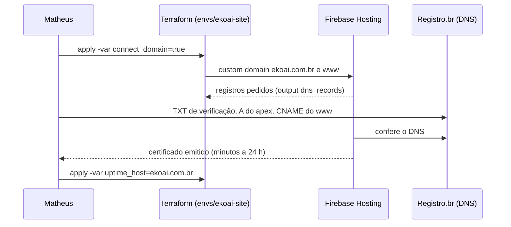

# SPEC 015: site da Ekoai em ekoai.com.br, vendendo direto

- **Status:** em andamento (21/10/2026). Infra aplicada; a página espera o protótipo.
- **Cartões:** pai [BEZ-131](https://linear.app/bez-company/issue/BEZ-131); spec e infra BEZ-132,
  protótipo BEZ-133, repositório e CI BEZ-134, implementação BEZ-136, domínio BEZ-137. Plataforma:
  cobrança BEZ-135, limite de taxa no cadastro BEZ-29, domínio do app BEZ-42, termos e privacidade BEZ-32.
- **Depende de:** [ADR 0016](../adr/0016-site-da-ekoai-estatico-no-hosting-do-ekoai-prod.md),
  [ADR 0015](../adr/0015-bez-cloud-platform.md), [ADR 0011](../adr/0011-design-system-neutro-ate-a-marca.md)
  (design system por tokens)
- **Repositório do site:** `bez-company/ekoai-website` (privado)

## Problema

O domínio `ekoai.com.br` foi registrado no Registro.br (DNS do próprio Registro.br, nenhum registro
criado). A Ekoai não tem página pública: quem ouve falar do produto não tem onde entender o que é,
ver o preço e assinar.

## Resultado esperado

1. `https://ekoai.com.br` apresenta o produto e leva a pessoa a **criar a conta pagante direto**. Todo
   CTA aponta para a compra. Não há lista de espera nem "fale com vendas".
2. A página nasce de um protótipo aprovado no Claude Design (desktop e celular).
3. A página fica no Google Cloud da BEZ, com deploy automático, preview por PR e custo perto de zero.
4. O domínio só liga quando a página estiver pronta: nada de "em breve" no ar.

**Fora de escopo:** blog, conteúdo para SEO além do básico (título, descrição, imagem de
compartilhamento, `robots.txt` e `sitemap.xml`), versão em inglês, analytics (entra com o banner de
consentimento do BEZ-44) e o checkout em si (BEZ-135).

## Decisões

| # | Decisão | Escolha | Por quê |
| --- | --- | --- | --- |
| D1 | Objetivo | vender direto: conta pagante | decisão do Matheus, 21/10/2026 |
| D2 | Hospedagem | Next.js estático no Firebase Hosting do `ekoai-prod`, site `ekoai` | ADR 0016: sem servidor, sem projeto novo, cabe na cota |
| D3 | Código | repositório privado `bez-company/ekoai-website` | decisão do Matheus; infra continua aqui |
| D4 | Domínios | apex = site, `www` redireciona para o apex, `app.` = plataforma | separa a página que muda por marketing do app que muda por produto |
| D5 | Antes da página | domínio desligado (`connect_domain=false`) | decisão do Matheus: não publicar "em breve" |
| D6 | Esteira do site | PR com preview de 7 dias; `main` no ar com `DEPLOY_LIVE=true` | uma página sem dado não precisa de staging |

### Conflito com o ADR 0004 e a SPEC 012

O ADR 0004 põe cobrança atrás de gates e a SPEC 012 diz "sem preço antes de validar com a Pilar". A
venda direta muda isso. A revisão do ADR 0004 entra no BEZ-135 (cobrança), com o que precisa ser
verdade antes de cobrar: a fase 2 (gerar post) funcionando, termos e privacidade publicados,
cadastro aberto com limite de taxa, CNPJ ativo no provedor de pagamento.

Consequência para esta SPEC: a página pode ficar pronta antes da cobrança, mas **só vai ao ar quando o
CTA leva a uma compra que funciona**. Uma página que vende algo que ainda não se compra queima a
primeira impressão.

## Requisitos

### R1. Protótipo (BEZ-133, dono Matheus)

Briefing em `docs/briefing-claude-design.md` do repositório do site: seções, texto de exemplo,
design system 06, estados, desktop (1440) e celular (390). O Matheus prototipa no Claude Design e
devolve o handoff bundle. Decidir no protótipo: promessa do hero, nomes e preços dos planos (ou
marcadores até o BEZ-135), exemplos de post e perguntas frequentes. O link do protótipo entra aqui.

### R2. Repositório e CI (BEZ-134)

Next.js 16 com `output: 'export'`, Tailwind 4 com os tokens do design system 06 (mesmos valores de
`platform/src/app/globals.css`), Sora e DM Mono locais, catraca de cor crua. CI: tipos, testes e
build; PR publica no canal `pr-<n>`; `main` publica no ar com `DEPLOY_LIVE=true`. Destino dos CTAs
num arquivo só (`src/lib/links.ts`).

### R3. Implementação (BEZ-136)

Portar o protótipo uma vez. Metadados, imagem de compartilhamento, favicon das gotas, `robots.txt`,
`sitemap.xml`, 404. Ao ligar, tirar o `noindex` do layout.

### R4. Infra (BEZ-132, aplicada em 21/10/2026)

`infra/terraform/envs/ekoai-site`: site `ekoai` do Hosting, conta `ekoai-site-deploy` só com
Hosting, provider `github-site` no pool `github` preso ao repositório do site, domínios atrás de
`connect_domain`, uptime check e alerta atrás de `uptime_host`.

### R5. Domínio (BEZ-137)

Os registros exatos vêm do output `dns_records` (o Firebase pode pedir um TXT de verificação além do
A e do CNAME). No Registro.br: Domínios › `ekoai.com.br` › DNS › Editar zona. Não criar nada em
`app.` (BEZ-42) nem MX (Workspace, BEZ-87).

## Verificação

- R2: o CI do PR publica o preview pelo Workload Identity, sem chave, e comenta o link.
- R3: o preview bate com o protótipo em desktop e celular (prints no PR); Lighthouse no celular acima
  de 90 em performance e acessibilidade.
- R5: `curl -I https://ekoai.com.br` dá 200; `http://` e `https://www.` dão 301 para o apex;
  certificado válido; uptime check verde; o CTA abre o cadastro em produção.

## Custo

Hosting dentro da franquia (10 GB armazenados, 360 MB por dia). Domínio R$ 40 por ano no Registro.br.
Uptime check dentro da franquia do Monitoring. Nenhum custo fixo novo no Google Cloud.
