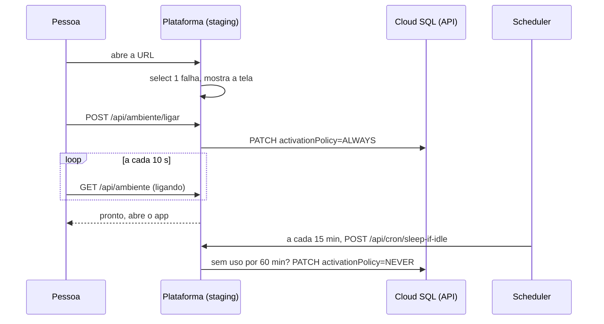

# SPEC 016: staging sob demanda, com tela "Ligar o ambiente" e corte por ociosidade

- **Status:** implementada, aguardando o `terraform apply` do staging (BEZ-216) e o teste de ponta a ponta.
- **Cartões:** BEZ-160 (corte por ociosidade e tela), BEZ-120 (probe sem banco), BEZ-102 (script e deploy que ligam o banco).
- **Protótipo aprovado (Claude Design):** https://claude.ai/artifact/FPvt2MeESBKBXEcS6niQyu
- **Depende de:** SPEC 013 da organização (níveis `lab`, `beta` e `production`; staging `beta` com banco ligado só nos testes).

## Problema

O Cloud SQL do staging custa cerca de R$ 83 por mês ligado e não escala a zero. O staging só é usado por uma pessoa,
em parte do dia. Já existia o jeito de desligar (`scripts/sql-power.sh`) e o deploy já liga o banco parado, mas nada
desligava sozinho, então o banco ficou ligado dia e noite (visto na fatura de 22/10/2026). E com o banco parado a URL
do staging não responde: o probe do Cloud Run usa `/api/health`, que consulta o banco, e o Cloud Run nem sobe instância.

## Resultado esperado

1. Abrir a URL do staging com o banco parado mostra a tela **"O ambiente de teste está desligado"**, com o botão **Ligar o ambiente**.
2. O botão liga o banco, mostra o andamento e abre o app sozinho quando o banco responde. Ligar leva cerca de 15 minutos
   (medido em 22/10/2026: 888 s do comando até a plataforma responder 200).
3. Depois de 60 minutos sem nenhuma requisição de gente, o banco desliga sozinho.
4. Produção não muda: nada disso existe lá (`WAKE_ENABLED` só é ligado pelo Terraform do staging).

## Decisões

| # | Decisão | Por quê |
|---|---|---|
| D1 | Só sob demanda, sem janela de horário | só o Matheus usa o staging hoje e aceita esperar os 15 min |
| D2 | O app mostra a tela, no layout raiz, quando `select 1` falha | funciona em qualquer página e não exige serviço novo; fora do staging a conferência não faz nada |
| D3 | O botão liga o banco; o `GET` nunca liga | robô e prévia de link não ligam o banco sem querer |
| D4 | O app liga e desliga o banco pela API do Cloud SQL, com um papel personalizado (`get`, `list`, `update`) | só a instância do projeto do staging; o mesmo papel do deploy |
| D5 | "Sem uso" = zero requisições de gente em 60 min, lido de uma métrica de log (`ekoai_user_requests`) | probes, cron e a própria tela não contam; é o que o app realmente serve |
| D6 | Falha em qualquer leitura deixa o banco **ligado** | errar para o lado do custo de R$ 0,09 por hora, nunca desligar em uso |
| D7 | Não desliga nos 60 min seguintes a uma operação de UPDATE do banco | a pessoa acabou de ligar e ainda não entrou |
| D8 | Probes do Cloud Run do staging em `/api/live` (só o processo) | com o banco parado a plataforma sobe e serve a tela; produção segue em `/api/health` |

## Fluxo

| Rota | Permissão | Corpo | Respostas |
|---|---|---|---|
| `GET /api/live` | pública | nenhum | 200 `{status}` |
| `GET /api/ambiente` | pública (exata) | nenhum | 200 `{state, elapsedS, estimateS, message}`; 404 fora do staging |
| `POST /api/ambiente/ligar` | pública (exata) | nenhum | 202 estado; 502 se o Google recusar; 404 fora do staging |
| `POST /api/cron/sleep-if-idle` | OIDC do Scheduler ou `CRON_SECRET` | nenhum | 200 `{action, reason, requests}`; 401; 500 sem desligar |

| Variável | Onde se define | Padrão |
|---|---|---|
| `WAKE_ENABLED` | Terraform, `wake_enabled` (só `envs/staging`) | desligado |
| `WAKE_SQL_PROJECT`, `WAKE_SQL_INSTANCE` | Terraform (o projeto e `ekoai-pg`) | obrigatórias com `WAKE_ENABLED` |
| `WAKE_IDLE_MINUTES` | Terraform, `wake_idle_minutes` | 60 (mínimo 15) |

## Custo

Banco de staging, micro a R$ 0,094 por hora mais R$ 15 de disco: sempre ligado R$ 83 por mês; sob demanda, 2 horas por dia,
cerca de R$ 21. O Scheduler e a métrica de log custam perto de zero.

## Fora de escopo

- Controlador central por rótulo para vários staging (entra quando houver o segundo staging com banco).
- Janela de horário que liga o banco antes de a pessoa chegar.
- Postgres serverless externo para staging (alternativa registrada no BEZ-160).

## Não verificado

Teste de ponta a ponta no GCP (o `terraform apply` do staging é manual, BEZ-216): ligar pelo botão, ver a tela até o banco
responder, e o corte por ociosidade com a métrica real. A permissão `cloudsql.instances.list` cobre a leitura das
operações segundo a documentação, mas só o primeiro `sleep-if-idle` real confirma.
