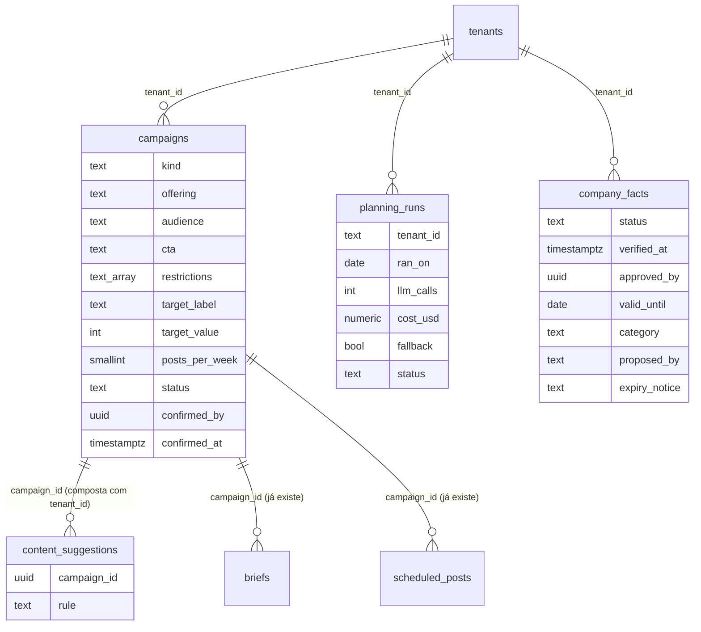

# SPEC 018: objetivos e campanhas no coordenador, e fatos da empresa com fonte, validade e aprovação

- **Status:** proposta, aguarda as decisões do Matheus (fim do arquivo) e o protótipo
- **Data:** 2026-10-23
- **Cards:** BEZ-261 (esta spec), BEZ-262 (campanhas), BEZ-263 (fatos)
- **Depende de:** [SPEC 017](017-do-primeiro-uso-a-rotina-de-posts.md) (decisão 8, coordenador),
  [SPEC 012](012-agentes-instagram-fase-2.md) (decisão 5, base de fatos; decisão 4, revisor por regra),
  [ADR 0019](../adr/0019-fato-confirmado-e-vigente.md), [ADR 0017](../adr/0017-eventos-de-produto-pelo-servidor.md)
- **Reaproveita:** BEZ-206 (analytics por conteúdo e horário), BEZ-207 (perfil: o que vende e para quem),
  BEZ-208 (exemplos que aprendem), BEZ-192 e BEZ-197 (kit da marca importado do site). Nada do motor da
  [SPEC 001](001-sistema-de-campanha-fase-a.md) volta: só a tabela `campaigns`, que já existe.
- **Protótipo:** v12 no mesmo artifact das fases 1 a 3 (https://claude.ai/artifact/55avs7vhgtwKFn9HMAR9Fz). Telas novas: Campanhas (lista, vazio, carregando, erro, nova, rascunho, ativa, pausada, encerrada), Início e Agenda com campanha, Fatos com validade e "Para revisar", Aprovar com fato vencido. Desktop e mobile. Aguarda aprovação do Matheus antes de qualquer código de tela

## Problema

1. **O coordenador sugere para preencher horário, não para chegar a um resultado.** Ele alterna
   objetivos de post (ensinar, produto, bastidores...) e puxa pelo engajamento, mas a empresa não tem
   como dizer "em novembro quero divulgar a agenda do mês" ou "quero vender o bolo de pote até o Dia das
   Mães". A sequência é coerente, mas genérica.
2. **Os fatos da empresa não têm prazo nem dono.** `company_facts` guarda texto, fonte e ligado ou
   desligado. Não diz quem confirmou, quando, até quando vale nem de que tipo é. Uma promoção vencida
   continua "valendo" para o revisor, e um fato que o agente propuser (importação do site, BEZ-192 e
   197) entraria como se a pessoa o tivesse escrito.
3. **As duas coisas se tocam.** Uma campanha de venda cita oferta, preço e prazo. Sem fato confirmado e
   vigente por baixo, a campanha é o caminho mais curto para um post com claim inventado.

## Resultado esperado

1. O administrador define uma campanha em um minuto (resultado, tipo, oferta, público, prazo, CTA,
   restrições) e confirma. Na semana seguinte, as sugestões do coordenador servem a ela, cada uma com o
   motivo em uma frase, e a pessoa continua decidindo (Criar, Trocar, Pular).
2. A Agenda mostra quais horários são da campanha e o progresso dela, sem prometer venda.
3. Nenhum post usa fato pendente, recusado ou vencido. Fato vindo de agente ou importação só passa a
   valer depois de uma pessoa confirmar. O administrador é avisado antes de um fato vencer.

**Métricas de produto:** % de contas com campanha confirmada; % de sugestões de campanha aprovadas
(contra as sem campanha); posts reprovados pelo revisor por fato fora da validade; fatos pendentes há
mais de 7 dias; custo de planejamento por conta por semana.

**Fora de escopo:** publicar sozinho (piloto automático segue pendente da decisão 8 da SPEC 017); atribuir
venda ou conversão a um post (só há curtida, comentário e alcance); a importação em si de fatos do site
(BEZ-192 e 197, aqui só o contrato de entrada); A/B de regra de planejamento (decisão 8); outras redes;
reavaliar fato na hora de publicar (card próprio, depende da frente de publicação).

## O que já existe (ponto de partida)

| Peça | Onde | Estado |
| --- | --- | --- |
| Planejador puro (sequência, promoção a cada 4, foto por semana, datas, engajamento) | `platform/src/lib/content-plan-model.ts` | Na staging (BEZ-239, 246) |
| Coordenador (I/O, Criar, Trocar, Pular, cron diário e aviso de segunda) | `content-coordinator.ts`, `/api/cron/plan-content` | Na staging |
| Sugestões | `content_suggestions` (migration 0030), índice único por horário aberto | Na staging |
| Ideia da sugestão | uma chamada de texto por rodada; se falha, `fallbackIdea` | Na staging |
| Campanha | tabela `campaigns` (migration 0006, SPEC 001): `slug`, `objective`, `start_date`, `end_date`, `status`, `kpi`, `phase`, `formats_mix`... Já está em `TENANT_TABLES`. `briefs.campaign_id` e `scheduled_posts.campaign_id` já existem. Nenhuma tela escreve nela | Legado, sem uso na Ekoai |
| Fatos | `company_facts` (migration 0023): `kind` (fact, never), `text`, `source` (site, owner, other), `source_note`, `active`. Tela em Configurações | Na staging |
| Revisor | `design/review.ts`: número fora dos fatos ativos, palavra proibida, "nunca afirmar" | Na staging |

## Decisões propostas

Cada uma tem a recomendação e o motivo. As marcadas com **(Matheus)** esperam a sua resposta.

### Campanhas (BEZ-262)

1. **Estender `campaigns`, sem tabela nova.** A tabela já é multi-tenant, já está em `TENANT_TABLES` e já
   liga a `briefs` e `scheduled_posts`. Colunas legadas sem uso (`kpi`, `phase`, `pillar`, `angle`,
   `formats_mix`, `budget_brl`, `context`) ficam quietas. `slug` continua obrigatório e único por conta:
   a campanha nova gera o slug do nome. `getActiveCampaign` segue valendo. **(Matheus)**

2. **O que a campanha guarda (colunas novas, todas aditivas):**

   | Coluna | Regra |
   | --- | --- |
   | `kind` | `divulgar`, `vender`, `captar`, `relacionar` ou `marca` (decisão 3) |
   | `objective` (já existe) | resultado desejado, 1 a 280 caracteres, escrito pela pessoa |
   | `offering`, `audience` | 1 a 280 caracteres cada |
   | `cta` | `link_bio`, `whatsapp`, `dm` ou nulo (nulo usa o `cta_default` do perfil) |
   | `restrictions` | até 5 itens, 750 caracteres no total ("não citar concorrente", "sem desconto") |
   | `target_label`, `target_value` | meta mensurável opcional, digitada pela pessoa ("pedidos pelo WhatsApp", 40). O modelo nunca sugere meta |
   | `posts_per_week` | 1 a 14, nulo usa o do perfil |
   | `status` | `draft`, `active`, `paused`, `ended`, `archived`. Hoje não há `check`: entra com `not valid` (só linha nova é checada) |
   | `confirmed_by`, `confirmed_at` | rascunho não influencia nada; só `brand.manage` confirma |
   | `created_by` | quem criou |

   Limites de tamanho valem no banco e a mensagem de cada campo vem do servidor (parser puro em
   `platform/src/lib/campaign-model.ts`, antes de qualquer I/O). Uma campanha ativa por conta,
   garantida por índice único parcial `(tenant_id) where status = 'active'` (decisão 2).

3. **Cinco tipos, cada um com os objetivos de post que o servem.** O tipo é lista fechada; o texto livre
   (oferta, público) só entra na ideia, nunca na escolha da sequência. **(Matheus)**

   | Tipo | Quando usar | Objetivos de post que ele puxa |
   | --- | --- | --- |
   | `divulgar` | evento, agenda, data, lançamento | novidade, bastidores, conversa |
   | `vender` | produto ou serviço com oferta | produto, promoção, prova social |
   | `captar` | pedidos de orçamento, mensagens, lista | conversa, produto, ensinar |
   | `relacionar` | aproximar do público | bastidores, conversa, prova social |
   | `marca` | ser lembrado, mostrar como trabalha | ensinar, bastidores, produto |

4. **Ligações.** `content_suggestions.campaign_id` (novo, FK composta `(tenant_id, campaign_id)` para
   `campaigns (tenant_id, id)`, `on delete set null (campaign_id)`, o que pede um índice único
   `campaigns (tenant_id, id)`) e `content_suggestions.rule` (`date`, `photo`, `rotation`, `campaign`:
   a regra que escolheu, para rastrear). Ao criar o pedido, a sugestão passa `campaign_id` ao `brief`; o
   `scheduled_post` herda do `brief`, como já está modelado. O post chega à campanha por
   `posts → scheduled_posts → campaign_id`, sem coluna nova em `posts`. As FKs antigas de `briefs` e
   `scheduled_posts` são de uma coluna só: o servidor só grava `campaign_id` depois de ler a campanha
   pelo `tenantDb` da conta (ver riscos).

5. **Planejamento com campanha, regra no lugar do modelo.** O planejador de hoje continua; a campanha é
   uma regra a mais, antes da rotação (regra 5 do modelo):
   1. Data comemorativa em até 3 dias segue ganhando o horário (regra 1 de hoje).
   2. **Campanha:** entre os horários livres da semana, a campanha ativa, confirmada e dentro da janela
      fica com até 60% (arredonda para cima, no mínimo 1), distribuídos alternados com o resto, nunca
      todos seguidos. O objetivo do post vem do tipo (decisão 3).
   3. Dentro da campanha valem as mesmas travas do planejador: não repetir o objetivo anterior, no
      máximo 1 promoção a cada 4 posts, foto real que casa com o tipo antes de imagem de IA.
   4. Horários que sobram seguem a rotação e o engajamento como hoje.
   5. Sem campanha, ou campanha que não vale hoje, o planejador é exatamente o de hoje.

   O modelo de texto continua escrevendo **só a ideia** (uma chamada por rodada). Ele não escolhe horário,
   objetivo nem foto. A entrada da chamada leva o resultado, a oferta, o público e as restrições da
   campanha, mais só os fatos confirmados e vigentes (decisão 5 de fatos). Oferta, preço e prazo que a
   pessoa digitou na campanha valem como afirmados só para os posts dela e só até o fim dela; o revisor
   aceita esses números nos posts com `campaign_id`.

6. **Fallback determinístico, custo com teto e idempotência.**
   - **Fallback:** modelo fora do ar, lento ou com resposta inválida, ou teto estourado: a ideia sai de
     `fallbackIdea` com o texto da campanha (`"<objetivo do post>: <oferta>"`, até 160 caracteres). A
     sequência, o motivo e os horários são os mesmos com ou sem modelo.
   - **Teto de custo:** uma chamada de texto por conta por rodada diária e no máximo 10 por conta por dia
     contando os "Trocar"; acima disso, só `fallbackIdea`. Teto por execução do cron configurável
     (`PLAN_BUDGET_USD_PER_RUN`); ao estourar, as contas que faltam usam `fallbackIdea`. Limite de saída
     de tokens já existente (1.200).
   - **Idempotência:** por horário, pelo índice único `content_suggestions_open_slot_idx`; por dia, por
     nova tabela `planning_runs`.
   - **`planning_runs`** (nova, uma linha por conta e dia): `tenant_id`, `ran_on` (data local),
     `llm_calls`, `cost_usd`, `suggested`, `fallback` (boolean), `status` (`done`, `failed`), `error_code`.
     Chave `(tenant_id, ran_on)`. É o registro do custo de planejamento (hoje só vai para log) e o que
     impede o cron de gastar duas vezes no mesmo dia.

7. **"Por que este post".** Frase única, até 200 caracteres, **montada por template** a partir da regra e
   da campanha, nunca escrita pelo modelo (rastreável e testável). Exemplos:
   - "Campanha Agenda de novembro: 2 de 4 posts da semana. Bastidores porque o último foi novidade."
   - "Campanha Bolo de pote: promoção só 1 vez a cada 4 posts; este é produto, com a foto 'forno' do banco."
   Aparece no cartão da sugestão (Início e Agenda) com a etiqueta da campanha, ao lado de Criar, Trocar e
   Pular. Sem campanha, a frase é a de hoje.

8. **Progresso na Agenda.** Por campanha: dias restantes, posts planejados, aprovados, publicados e a
   cadência (publicados na semana contra `posts_per_week`). Engajamento da campanha (curtidas, comentários
   e, quando houver, alcance) como número ao lado da média da conta. **Nunca** "vendas", "conversões" nem
   "retorno": a tela diz "engajamento" e o texto de ajuda lembra que isso não mede venda. A meta
   mensurável digitada (`target_*`) é mostrada como a pessoa a escreveu, atualizada por ela, não calculada.
   **(Matheus)** confirmar se a pessoa atualiza o número da meta à mão ou se essa linha fica fora do MVP.

9. **Ciclo da campanha.** `draft` → `active` (confirmar, só `brand.manage`) → `paused` ↔ `active` →
   `ended` (automático quando `end_date` passa, no cron, ou à mão) → `archived`. Ao terminar, aviso ao
   admin com o resumo (publicados, engajamento, cadência) e o planejador volta ao modo sem campanha.

10. **A/B de regra de planejamento: fora do MVP.** Uma conta publica 2 a 5 posts por semana; não há volume
    para separar efeito de regra. Fica no card de analytics (BEZ-206) quando houver conta suficiente.
    **(Matheus)**

### Fatos (BEZ-263)

1. **Colunas novas em `company_facts`:**

   | Coluna | Regra |
   | --- | --- |
   | `status` | `pending`, `confirmed` ou `rejected`. Default do banco depois da migração: `pending` |
   | `verified_at` | quando uma pessoa confirmou (obrigatório se `confirmed`, `check`) |
   | `approved_by` | quem confirmou, `references users on delete set null` |
   | `valid_until` | data (dia local), opcional; fato sem data não vence |
   | `category` | `oferta_preco`, `prazo_horario`, `contato_endereco`, `numero_resultado`, `certificacao_regra`, `sobre_a_empresa` ou `outro` |
   | `proposed_by` | `person` ou `agent` (importação do site, kit da marca): quem escreveu o texto |
   | `expiry_notice` | `soon`, `expired` ou nulo: o último aviso enviado, para não repetir |

   **Vencido é derivado** (`confirmed` e `valid_until < hoje`), não gravado, para não depender de job nem
   de relógio do banco. A migration é aditiva e reaplicável: adiciona as colunas com default
   `confirmed`, preenche `verified_at = created_at` nas linhas antigas e troca o default para `pending`
   (segunda aplicação não muda nada).

2. **Nunca afirmar (`kind = never`) vale sempre que estiver ativo, tenha status ou prazo.** É o lado seguro:
   mais restrição nunca publica claim errado. Só `rejected` o desliga. Validade e confirmação mandam em
   `kind = fact`.

3. **O modelo propõe, a pessoa confirma.** Importação e agente gravam `proposed_by = 'agent'` e
   `status = 'pending'`; a rota de importação não aceita outro valor. Só `brand.manage` muda para
   `confirmed`, pela rota de confirmar, que grava `verified_at` e `approved_by`. Editar o texto de um fato
   confirmado o devolve a `pending` (a confirmação era do texto antigo). Decisão transversal: ver o
   [ADR 0019](../adr/0019-fato-confirmado-e-vigente.md).

4. **Categoria dá a validade sugerida, a pessoa edita.** Ao criar, o servidor sugere `valid_until` pela
   categoria: oferta e preço 30 dias; prazo e horário 90; número e resultado 180; os demais, sem data.
   **(Matheus)**

5. **Geração só usa o que vale.** `factsForPrompt` passa a devolver só fato `confirmed` e vigente (mais os
   `never` ativos). Fato pendente, recusado ou vencido não chega ao prompt do redator.

6. **O revisor bloqueia o que só existe em fato que não vale.** `reviewText` ganha `inactive`: os fatos
   pendentes, recusados e vencidos, cada um com o motivo. Um número presente em `inactive` e ausente dos
   fatos que valem reprova com a regra `fact_not_valid` e a frase "O número 40 vem de um fato vencido
   em 12/11. Confirme ou atualize o fato." O que `inactive` não consegue ver (claim sem número) segue
   coberto por `never` e pelo prompt, que não recebeu o fato.

7. **Aviso de vencimento.** O cron diário existente varre `valid_until`: 7 dias antes (`soon`) e depois
   do prazo (`expired`). Cada fato é avisado uma vez por etapa (`expiry_notice`), e a notificação sai agrupada
   por conta e etapa ("2 fatos da empresa vencem em 7 dias"), para a audiência `admin`, com o link para a
   tela de fatos. O texto do fato nunca vai na notificação, só a categoria ("Uma oferta
   vence em 7 dias").

8. **Contrato de entrada da importação (BEZ-192 e 197).** A importação grava `source = 'site'`,
   `source_note` com a URL (https, até 200 caracteres), `proposed_by = 'agent'`, `status = 'pending'`,
   `category` sugerida. Nenhum caminho do agente grava `confirmed`. A tela "Revisar fatos importados"
   lista os pendentes com Confirmar, Editar e Recusar. Confirmar em lote por seleção é permitido (a pessoa
   marca os que leu); "confirmar todos" sem seleção, não. **(Matheus)**

9. **Fatos que já existem.** Viram `confirmed` com `verified_at = created_at`: foram digitados por um
   administrador. **(Matheus)** confirmar ou pedir nova confirmação (recomendado manter).

10. **Post já aprovado cujo fato vence depois.** Fora desta spec: a checagem na hora de publicar mexe em
    `publish.ts`, que é da frente de publicação confiável. Até lá, o limite é a Aprovar: o post é revisado
    quando gerado e quando editado. Card próprio quando a frente de publicação fechar.

## Modelo de dados

**Restrições novas** (todas em migration aditiva e reaplicável, o CI aplica duas vezes; sem apagar
coluna nem tabela, sem `-- allow-destructive`):

| Tabela | Restrição |
| --- | --- |
| `campaigns` | `kind` em lista; `offering` e `audience` 1 a 280; `restrictions` até 5 itens e 750 caracteres; `cta` em lista; `posts_per_week` 1 a 14; `target_value >= 0`; `status` em lista (`not valid`); `confirmed_at` obrigatório fora de `draft` |
| `campaigns` | índice único `(tenant_id, id)` (para a FK composta); índice único parcial `(tenant_id) where status = 'active'` |
| `content_suggestions` | `campaign_id` com FK composta `(tenant_id, campaign_id)`; `rule` em lista |
| `planning_runs` | chave `(tenant_id, ran_on)`; `llm_calls >= 0`; `cost_usd >= 0` |
| `company_facts` | `status`, `category`, `proposed_by` e `expiry_notice` em lista; `confirmed` exige `verified_at` |

**RLS e permissões:**

| Tabela | Ler | Escrever |
| --- | --- | --- |
| `campaigns` | `content.view` (hoje é qualquer membro) | `brand.manage`. A policy de escrita atual segue `content.edit` (criador escreve): a migration a troca para `brand.manage` |
| `content_suggestions` | `content.view` (como hoje) | só o servidor |
| `planning_runs` | `audit.view` | só o servidor |
| `company_facts` | `profile.view` (como hoje) | `brand.manage` (como hoje); confirmar e recusar usam a mesma policy |

`planning_runs` entra em `TENANT_TABLES` (`platform/src/lib/tenant-tables.ts`), com teste de RLS
(`rls_test.sql`) e de escopo de conta (`tests/tenant-scope.test.js`). A exclusão da conta apaga as linhas
novas por `on delete cascade`.

## Rotas

| Rota | Permissão | Corpo | Respostas |
| --- | --- | --- | --- |
| `GET /api/campaigns` | `content.view` | | 200 lista da conta |
| `POST /api/campaigns` | `brand.manage` | campo por campo, validado no parser | 201; 400 com o campo; 403 |
| `PATCH /api/campaigns/[id]` | `brand.manage` | campos editáveis (rascunho ou ativa) | 200; 400; 403; 404 |
| `POST /api/campaigns/[id]/confirm` | `brand.manage` | | 200; 409 se já há outra ativa; 403; 404 |
| `POST /api/campaigns/[id]/pause`, `/resume`, `/end` | `brand.manage` | | 200; 409 estado inválido; 403; 404 |
| `GET /api/campaigns/[id]/progress` | `content.view` | | 200 contagens e engajamento |
| `POST /api/facts/[id]/confirm` | `brand.manage` | `valid_until` opcional | 200; 403; 404 |
| `POST /api/facts/[id]/reject` | `brand.manage` | | 200; 403; 404 |
| `POST /api/facts/[id]/restore` | `brand.manage` | | 200; 403; 404 (desfaz a recusa: volta a pendente) |
| `POST /api/facts/confirm-many` | `brand.manage` | `ids` (1 a 50, UUID) | 200 com o total; 400; 403 |

Toda rota declara a permissão (`tests/route-permissions.test.js`). Nenhuma é pública. Eventos de produto
(`campaign_created`, `campaign_confirmed`, `fact_confirmed`, `fact_rejected`, e `campaign_id` nos eventos
de sugestão) saem pelo servidor, sem PII, no `analytics.ts` do [ADR 0017](../adr/0017-eventos-de-produto-pelo-servidor.md);
quem mexe nesse arquivo hoje é a frente de scorecard, então entram depois dela. A auditoria registra
`campaign.*` e `facts.confirmed` e `facts.rejected` sem o texto.

## Telas (protótipo antes do código)

Cada uma em desktop e mobile, com vazio, carregando, erro e cheio.

1. **Campanha**, em lista e formulário (hoje não há tela). Formulário em uma coluna: "O que você quer
   alcançar?" (resultado), tipo em cartões com exemplo, oferta, público, prazo, CTA, restrições, meta
   opcional. Botão **Confirmar campanha**. Lista com a ativa no topo.
   - *Vazio:* "Diga ao coordenador o que você quer com os posts. Crie uma campanha e as sugestões da
     semana passam a servir a ela." Botão **Criar campanha**. Sem campanha, nada quebra: o coordenador
     segue como hoje.
   - *Erro:* "Não foi possível salvar a campanha. Seus dados continuam no formulário. Tente de novo."
   - *Rascunho:* faixa "Confirme a campanha para o coordenador usá-la".
2. **Início e Agenda com campanha:** o cartão da sugestão ganha a etiqueta da campanha e o motivo; a
   Agenda marca os horários da campanha e mostra o cartão de progresso.
   - *Sem horários na agenda:* igual a hoje ("Defina os horários para receber sugestões").
   - *Todos os horários ocupados:* "Todos os horários da semana já têm post."
   - *Falha no planejamento:* "Não foi possível montar as sugestões desta semana. Tente de novo ou crie
     um post agora." Botão **Tentar de novo** (respeita o teto de custo; ao estourar, a mensagem diz que
     as sugestões usam o modo simples).
3. **Fatos:** a tela de Configurações ganha estado, validade e categoria por fato, a aba **Para revisar**
   com os pendentes (Confirmar, Editar, Recusar, seleção para confirmar vários) e o selo "Vence em N dias".
   - *Vazio:* "Cadastre o que a empresa pode afirmar: preços, horários, prazos, certificações. O post só
     usa o que estiver aqui, confirmado e dentro da validade." Botão **Adicionar fato**.
   - *Nada para revisar:* "Todos os fatos estão confirmados."
   - *Erro:* "Não foi possível carregar os fatos. Recarregue a página; nada foi alterado."
4. **Aprovar:** quando o revisor reprova por `fact_not_valid`, a mensagem do post aponta o fato e o
   link para atualizá-lo.

Microcopy: voz ativa, sentence case, verbo no botão, sem travessão.

## Critérios de aceite

Cada um tem como verificar.

**Campanhas**
1. Conta com campanha confirmada, no próximo planejamento, recebe sugestões com 1 a 60% dos horários da
   semana na campanha, sem repetir objetivo em sequência e com no máximo 1 promoção a cada 4 posts
   (teste do modelo puro com datas fixas).
2. Rascunho, pausada, encerrada ou fora da janela não muda o resultado do planejador: a saída é idêntica à
   de uma conta sem campanha (teste de igualdade).
3. Com o modelo falhando, lento ou acima do teto, a sugestão sai com `fallbackIdea` e o mesmo
   horário, objetivo e motivo; modelo simulado que falha se for chamado além do teto.
4. Dois planejamentos ao mesmo tempo na mesma conta e no mesmo dia gravam uma linha em `planning_runs`,
   uma sugestão por horário e uma cobrança (teste contra Postgres real).
5. Toda sugestão tem `reason` de até 200 caracteres montado por template, com `rule` e, quando há,
   `campaign_id`; teste que reprova `reason` que não bate com o template da regra.
6. Nenhuma sugestão cria `scheduled_post` sem Criar (teste: depois do cron, `scheduled_posts` e `briefs`
   não ganham linha).
7. Criador e leitor recebem 403 em criar, editar, confirmar, pausar e encerrar; conta A não lê nem
   altera campanha, progresso ou sugestão da conta B (teste de rota, `rls_test.sql` e `tenant-scope`).
8. O progresso mostra planejados, aprovados, publicados, cadência e engajamento; teste de texto garante
   que a tela não contém "venda", "conversão" nem "retorno".
9. Duas campanhas ativas na mesma conta: a segunda confirmação recebe 409 e o banco rejeita o insert direto.

**Fatos**
10. Fato de origem `agent` entra `pending`; a rota e o parser não aceitam `status = confirmed` nessa
    origem (teste de rota e de parser).
11. `factsForPrompt` não devolve fato pendente, recusado nem vencido, e devolve todos os `never` ativos
    (teste do modelo puro com data fixa).
12. `reviewText` reprova com `fact_not_valid` o post cujo número só aparece em fato vencido, recusado ou
    pendente, e não reprova quando o mesmo número também está em fato vigente (teste do revisor).
13. O aviso de vencimento sai 1 vez em 7 dias e 1 vez no dia, só para admin, sem o texto do fato; rodar o
    cron duas vezes não repete (teste do job com `expiry_notice`).
14. A migration, aplicada duas vezes, mantém todas as linhas antigas como `confirmed` com `verified_at`
    igual a `created_at` (teste no CI, que já aplica duas vezes).
15. Editar o texto de um fato confirmado o devolve a `pending`.
16. Confirmar, recusar e editar exigem `brand.manage`; conta A não vê nem altera fato da conta B (teste de
    rota, RLS e `tenant-scope`). A auditoria registra a ação sem gravar o texto.

**Os dois**
17. Post de campanha com número digitado na oferta da campanha passa no revisor; o mesmo número em post
    sem `campaign_id` reprova se não estiver em fato vigente.
18. Prints no PR de cada tela, desktop e mobile, com vazio, carregando, erro e cheio, e dado fictício.
19. Protótipo aprovado antes do código de cada tela, com o link na PR.

## Entregas

| # | Entrega | Verificação | Card |
| --- | --- | --- | --- |
| 0 | Esta spec e o ADR 0019 | Revisão do Matheus | BEZ-261 |
| 1 | Protótipo das telas (Claude Design), só com ordem do Matheus | Link aprovado | BEZ-261 |
| 2 | Fatos: migration, `factsForPrompt` e revisor, confirmar e recusar, aviso de vencimento | Critérios 10 a 16 | BEZ-263 |
| 3 | Tela de fatos (estado, validade, Para revisar) | Prints, critério 18 | BEZ-263 |
| 4 | Campanhas: migration, parser, rotas e `planning_runs` | Critérios 4, 7 e 9 | BEZ-262 |
| 5 | Planejador com campanha, fallback, teto e motivo por template | Critérios 1 a 3, 5 e 6 | BEZ-262 |
| 6 | Telas de campanha, Início e Agenda, progresso | Prints, critérios 8 e 18 | BEZ-262 |

A ordem põe os fatos antes: a campanha cita oferta e preço, e o que ela pode afirmar precisa estar
protegido antes de existir.

## Riscos

| Risco | Efeito | Mitigação |
| --- | --- | --- |
| `campaigns` é legado: duas ativas na mesma conta quebram o índice único parcial | Migration falha onde houver | Contar antes, na staging e na produção, com uma consulta somente leitura anotada na PR; sem linha duplicada, o índice entra |
| FKs antigas de `briefs` e `scheduled_posts` não amarram o `tenant_id` | Gravar `campaign_id` de outra conta | O servidor só grava depois de ler a campanha pelo `tenantDb` da conta; teste de isolamento; hardening das FKs vira card se o legado for usado |
| O modelo inventa oferta, preço ou prazo na ideia | Claim falso no post | O modelo só escreve a ideia, com fatos vigentes e a oferta digitada; o revisor segue aplicado ao post final; `restrictions` entram no prompt |
| Engajamento lido como venda | Pessoa conclui que a campanha vendeu | A tela só diz "engajamento"; critério 8 testa o texto |
| Custo de planejamento cresce com contas | Gasto fora do controle | Teto por conta, por dia e por execução; `planning_runs` mostra o custo |
| Fatos pendentes se acumulam | Posts sem número, sensação de produto "travado" | Aviso aos 7 dias; o post sem número ainda sai; métrica de pendentes há mais de 7 dias |
| Data de validade e fuso (a plataforma usa -3 como base do planejador) | Fato vence um dia antes ou depois | `valid_until` é dia local; o teste usa data fixa e fronteira de meia-noite |
| A checagem na publicação (decisão 10 de fatos) fica de fora | Post aprovado antes do vencimento sai depois dele | Dito aqui; card próprio com a frente de publicação; enquanto isso, o aviso de 7 dias dá margem |
| Conflito de arquivos com outras frentes (`publish.ts`, `analytics.ts`) | Merge difícil | Esta spec não toca nenhum dos dois; os cards de código esperam as frentes fecharem |

## Decisões do Matheus

- [ ] **Campanhas 1:** estender `campaigns` (recomendado) ou criar `marketing_campaigns`?
- [ ] **Campanhas 2:** uma campanha ativa por conta (recomendado) ou várias ao mesmo tempo?
- [ ] **Campanhas 3:** os cinco tipos (divulgar, vender, captar, relacionar, marca) estão bons? Falta algum nicho (imóvel, cardápio)?
- [ ] **Campanhas 5:** 60% dos horários da semana para a campanha (recomendado) ou outro teto?
- [ ] **Campanhas 8:** a pessoa atualiza a meta mensurável à mão (recomendado) ou a meta fica fora do MVP?
- [ ] **Campanhas 10:** A/B de regra fora do MVP (recomendado)?
- [ ] **Fatos 4:** validade sugerida por categoria (oferta 30 dias, prazo 90, número 180, o resto sem data)?
- [ ] **Fatos 8:** confirmar vários por seleção, sem "confirmar todos" (recomendado)?
- [ ] **Fatos 9:** fatos que já existem ficam confirmados (recomendado) ou pedem nova confirmação?
- [ ] **Fatos 2:** "nunca afirmar" vale sempre, mesmo pendente (recomendado)?
