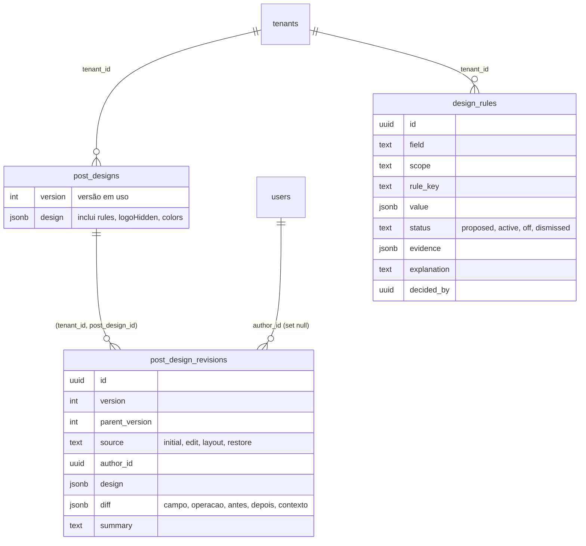
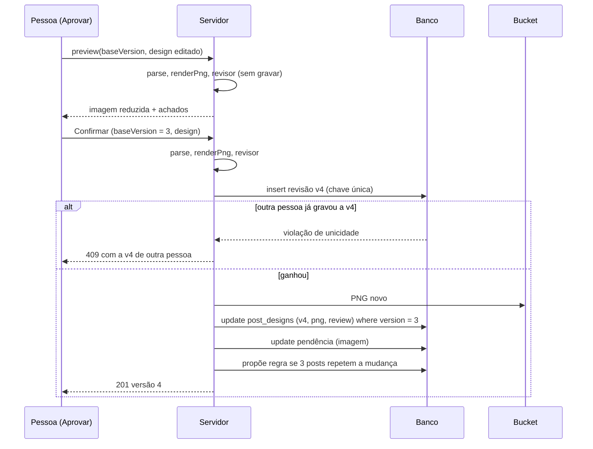

# SPEC 019: ajuste rápido do post, versões e aprendizado com a edição

- **Status:** proposta, aguarda as decisões do Matheus (fim do arquivo) e o protótipo v13
- **Data:** 2026-10-23
- **Cards:** BEZ-266 (esta spec), BEZ-267 a BEZ-271 (entregas a a e); pai BEZ-205
- **Depende de:** [SPEC 012](012-agentes-instagram-fase-2.md) (decisões 1 e 4, motor híbrido e revisor por
  regra; R3, edição do texto na imagem), [SPEC 017](017-do-primeiro-uso-a-rotina-de-posts.md) (Aprovar,
  etiquetas de estado), [SPEC 018](018-objetivos-campanhas-e-fatos.md) (fato vigente no revisor),
  [ADR 0017](../adr/0017-motor-de-design-hibrido-com-biblioteca-de-layouts.md) (famílias de layout),
  [ADR 0017 de eventos](../adr/0017-eventos-de-produto-pelo-servidor.md), [ADR 0020](../adr/0020-revisao-imutavel-com-diff-por-campo.md)
- **Ideias que esta spec fecha:** BEZ-195 (versões, Restaurar padrão, Confirmar), BEZ-201 (aprender com a
  edição), BEZ-202 (trocar layout sem chamar o modelo)
- **Fica fora, com gatilho de dado (seção "Fase 3"):** BEZ-194 (arrastar elementos), BEZ-196 completo (Estúdio)
- **Fica em card próprio:** BEZ-193 (pedir ajuste em texto livre), BEZ-257 (alt text editável), BEZ-208, 209, 200
- **Protótipo:** v13 publicada em 23/10/2026 no mesmo artifact das fases anteriores
  (https://claude.ai/artifact/55avs7vhgtwKFn9HMAR9Fz, versão 13, `version_id` 1792728726-05ec). No seletor do alto:
  tela **Ajuste rápido do post** (grupo "Fase 5": painel, editando, trocar layout, revisor trava por contraste e por
  palavra proibida, salvando, versão salva e regra proposta, versões, versão antiga, conflito, erro ao salvar, post já
  aprovado, carregando) e, em **Aprendizado**, as variantes "Design do post" (proposta, aceita, ativas e desligada,
  dispensada, vazio, carregando, erro). Desktop e celular, e os papéis (leitor só vê as versões). Aguarda aprovação do
  Matheus antes de qualquer código de tela

## Problema

1. **Corrigir um detalhe custa uma regeneração.** O que existe hoje para mexer num post pronto é
   editar a legenda, aplicar um atalho de legenda ou pedir "outra direção", que chama o modelo de imagem,
   gasta o limite do mês e troca o visual inteiro. Quem só quer mover o logo, tirar o subtítulo ou
   escurecer o título não tem caminho barato.
2. **A edição some.** Quando a pessoa ajusta um post, nada guarda o que mudou, quem mudou nem de qual
   versão partiu. Não há como voltar, não há como dois editores se enxergarem e o sistema não aprende
   nada com o ajuste.
3. **A pessoa repete o mesmo ajuste em todo post.** Se o logo sempre vai para o canto inferior direito,
   ela vai mover em cada post até desistir. O Aprendizado de hoje só nasce da recusa com motivo
   (SPEC 003), não da edição.

## Resultado esperado

1. Ajustar texto, layout, cor do texto e logo de um post pendente em segundos, vendo o resultado na hora,
   **sem chamar o modelo e sem gastar o limite do mês** (custo de modelo zero).
2. Cada ajuste confirmado vira uma **versão** com o que mudou, quem mudou e de qual versão partiu.
   Dá para desfazer, restaurar o padrão e voltar a qualquer versão sem perder as outras.
3. Dois editores no mesmo post nunca se sobrescrevem em silêncio.
4. Quando a pessoa faz **a mesma mudança em 3 posts diferentes**, a Ekoai propõe uma regra de marca com a
   explicação, o administrador aceita, e os próximos posts já nascem assim. A regra pode ser desligada.
5. O revisor por regra continua barrando contraste baixo, texto fora da margem e fato fora da base,
   **inclusive depois de edição manual**.

**Métricas de produto (Gate 4 do plano):** ajustes repetidos por post caem; aprovação sem edição sobe
frente à linha de base da própria conta; corrigir um detalhe custa menos tempo e dinheiro que
regenerar. Os eventos que medem cada uma estão em "Medição".

**Fora de escopo:** arrastar elementos e Estúdio completo (fase 3, só com gatilho de dado); pedir ajuste
em texto livre por modelo (BEZ-193); editar a legenda e as hashtags dentro da versão (a legenda segue
como hoje; entra na revisão numa spec seguinte, ver decisão 9); variações de logo e paletas (BEZ-209);
alt text editável (BEZ-257); exemplos que aprendem (BEZ-208); editar post já aprovado ou publicado.

## O que já existe (ponto de partida)

| Peça | Onde | Estado |
| --- | --- | --- |
| Design do post | `post_designs` (migration 0023): `design` (jsonb, até 64 KB), `layout`, `visual_key`, `png_key`, `review`, `version` (default 1) | Na staging |
| Modelo do design | `platform/src/lib/design/model.ts`: `DesignSpec`, `StoredDesign` (`layout`, `texts`, `logoCorner`) | Na staging |
| Render sem modelo | `design/render.ts` (`renderPng`, resvg, mesma entrada gera o mesmo PNG), `design/families.ts` | Na staging |
| Revisor por regra | `design/review.ts`: `reviewLayout` (fonte, margem, contraste, sobreposição), `reviewText` (palavra proibida, acento, número fora dos fatos, `fact_not_valid`) | Na staging |
| Pendência | `pending_approvals.post_design_id` e `images[0]` (url e path do PNG) | Na staging |
| Feedback e regras de texto | `feedback`, `style_rules` (ligar e desligar na tela Aprendizado), `learning.ts` | Na staging |
| Eventos de produto | `analytics.ts` (sem PII), `product-events.ts` (`post_ready`, `cost_by_step`) | Na staging |
| Limite de taxa | `rate-limit.ts` | Na staging |

O que **não** existe: nenhuma rota edita o design de um post; `post_designs.version` nunca muda; não há
histórico, diff nem regra aprendida do design.

## Decisões propostas

Cada uma tem a recomendação e o motivo. As marcadas com **(Matheus)** esperam a sua resposta.

### Fase 1: ajuste rápido sem chamar o modelo

1. **O que se ajusta (lista fechada).** Só o que o render já sabe redesenhar sem o visual:

   | Campo | Valores | Observação |
   | --- | --- | --- |
   | `texts.kicker`, `texts.title`, `texts.sub` | texto, 1 a 280 caracteres; kicker e sub podem ser removidos | Título não pode ficar vazio |
   | `texts.items.N` (0 a 9) | texto, 1 a 280 | Lista numerada; adicionar e remover item muda `texts.items` |
   | `layout` | uma família compatível (decisão 2) | Troca de layout (BEZ-202) |
   | `logoCorner` | `tl`, `tr`, `bl`, `br` | Já existe em `StoredDesign` |
   | `logoHidden` | verdadeiro ou falso | Esconder o logo neste post. Novo em `StoredDesign` |
   | `colors.title`, `colors.sub`, `colors.kicker`, `colors.items` | cor em hex, ou nenhuma (volta à da marca) | Cor do texto. Novo em `StoredDesign`. O revisor mede o contraste (decisão 5) |

   A marca (cores principais, fontes) e o logo em si **continuam vindo do perfil**, como na SPEC 012: o post
   não troca de fonte nem de paleta. O visual (fundo gerado ou foto) não muda aqui; só "Outra direção"
   o troca, e isso segue contando no limite.

2. **Trocar layout sem chamar o modelo (BEZ-202).** A família muda; texto, visual em cache e logo ficam.
   Compatível = `kind` igual ao do post, com os requisitos da família: lista numerada pede 2 ou mais
   itens; foto-título, foto-janela e foto-arco pedem visual. Função pura `compatibleLayouts(kind, texts,
   hasVisual)` em `design/model.ts`. A miniatura de cada família sai do mesmo render.

3. **A prévia é do servidor, nunca do navegador.** O navegador manda o design editado, o servidor
   desenha (`renderPng`) e devolve a imagem e os achados do revisor. Assim a prévia é byte a byte o PNG
   que será salvo (critério do BEZ-196) e o navegador não carrega fontes nem o motor. A prévia **não grava
   nada**: não cria versão, não troca o PNG do post. Limitada por conta (`rate-limit.ts`, 60 por minuto).
   A imagem desce reduzida (540 px de largura) para a tela e inteira só no Confirmar.

4. **Desfazer, Refazer e Restaurar padrão são do navegador; Confirmar é do servidor.** Durante a
   edição, a pilha de desfazer vive na tela e nada vai ao banco. **Restaurar padrão** descarta o que
   ainda não foi confirmado e volta à versão em uso. **Confirmar** salva uma versão (decisão 6). Sair da
   tela com mudança não confirmada pede confirmação e registra `design_edit_discarded`.

5. **O revisor roda a cada prévia e é a barreira do Confirmar.** O servidor reprova o Confirmar com
   qualquer destes achados, mesmo se a tela deixar passar: contraste abaixo do mínimo (4,5:1; 3:1 para
   título de 56 px ou mais em negrito), texto fora da margem de segurança do feed, sobreposição, fonte
   abaixo do mínimo, texto que não cabe, palavra proibida, "nunca afirmar", número fora dos fatos
   vigentes (`fact_not_valid`, SPEC 018). É o conjunto `BLOCKING` de hoje mais `safe_margin` e
   `font_size`, que o motor sozinho nunca gera mas a edição manual pode. Definido como `EDIT_BLOCKING`
   em `review.ts`. A prévia mostra o motivo em linguagem simples e o Confirmar fica desligado.

### Fase 2: revisões e conflito

6. **Revisão imutável, uma por versão** ([ADR 0020](../adr/0020-revisao-imutavel-com-diff-por-campo.md)).
   Tabela `post_design_revisions`. Cada Confirmar grava uma linha nova com o design completo da versão,
   o diff contra a versão de origem, o autor e o resumo. Nunca se altera nem se apaga uma revisão, a não
   ser pela limpeza de retenção (decisão 8) ou pela exclusão da conta. **Voltar a uma versão antiga cria
   uma versão nova** (`source = restore`, com o design da antiga); não apaga as seguintes (BEZ-195).

7. **Versão em uso e proteção contra atualização perdida.**
   - `post_designs.version` é a versão em uso. A v1 é o que a geração fez (`source = initial`, sem autor).
     Para não tocar `generation.ts`, a v1 é gravada na primeira edição, a partir do `post_designs.design`
     da época (idempotente pela chave única).
   - Toda gravação diz de qual versão partiu (`baseVersion`). O servidor insere a revisão
     `baseVersion + 1`. A **chave única `(tenant_id, post_design_id, version)` é o cadeado**: quem
     perde a corrida recebe violação de unicidade e a rota devolve **409** com a versão atual, o autor e o
     resumo dela. Só quem inseriu atualiza `post_designs` (design, layout, PNG, revisão do revisor,
     versão), com `where version = baseVersion`. Sem transação nova, no padrão da reserva de
     `generation_runs`.
   - Se o servidor cair entre inserir a revisão e atualizar o post, a versão em uso fica atrás da última
     revisão. A próxima leitura detecta (`max(version) > post_designs.version`) e completa a atualização.
     Nenhum dado se perde, porque a revisão é a fonte da verdade.
   - **Aprovar leva `designVersion`.** A tela de Aprovar manda a versão que a pessoa estava vendo; se a
     versão em uso mudou desde então, a aprovação devolve 409 ("O post mudou enquanto você olhava. Veja a
     versão atual."). Sem o campo, a aprovação segue como hoje (compatível com o que já existe). A
     aprovação grava a versão aprovada em `pending_approvals.seed.design_version`.
   - Só se edita post `awaiting_decision`. Aprovado, agendado, publicado, recusado ou arquivado: 409.

8. **Retenção e o que se guarda.** Revisão guarda **parâmetros**, não PNG (BEZ-195): o PNG da versão se
   redesenha na hora (`GET .../revisions/N/png`, privado, com cache curto). Só a versão em uso tem PNG no
   bucket (`post_designs.png_key`), trocado a cada Confirmar; o PNG antigo é apagado depois da troca (falha
   ao apagar vira aviso no log, não erro). Máximo de **20 revisões por post**: ao passar disso, a limpeza
   apaga a mais antiga que não seja a v1 nem a versão em uso. Revisões saem junto com o post e com a
   conta (`on delete cascade`); a exclusão da conta já apaga o bucket pelo caminho de hoje.

### Diff estruturado e medição

9. **O diff é `[{campo, antes, depois, contexto}]`, calculado pelo servidor.** O cliente nunca manda diff.
   `campo` vem da lista da decisão 1; `operacao` é `set`, `add` ou `remove`; `antes` e `depois` são valores
   escalares (texto de até 280 caracteres, hex, canto, booleano ou nulo); `contexto` é
   `{kind, layout, ratio, goal}` do post depois da mudança. Resumo de até 160 caracteres **por template**
   ("Subtítulo removido", "Logo movido para o canto inferior direito", "3 ajustes: título alterado,
   subtítulo removido, logo movido"), nunca escrito por modelo. Função pura `diffDesigns(before, after,
   context)` em `design/diff.ts`.

10. **Texto livre guarda o antes e o depois na revisão, mas nunca vira regra nem evento.** Título e
    subtítulo editados ficam na revisão (a conta vê o próprio histórico, com RLS), servem ao desfazer e à
    leitura humana, e **nunca** saem para analytics nem entram em regra. Só mudança **categórica** é elegível
    a regra (decisão 11).

### Aprender com a edição

11. **A regra nasce da mudança líquida repetida em posts diferentes.**
    - **Elegíveis:** `layout` (por tipo de post), `logoCorner`, `logoHidden`, remover `texts.sub`, remover
      `texts.kicker`, `colors.title` e `colors.sub` (valor hex exato). Texto livre não é elegível.
    - **Contagem por post, pela mudança líquida:** compara o valor da v1 com o da versão em uso. Se a
      pessoa moveu o logo e depois devolveu, não conta. Mover duas vezes para o mesmo canto no mesmo post
      conta uma vez. Só entram posts `awaiting_decision`, aprovados, agendados ou publicados (recusado e
      arquivado não valem: a edição pode ter sido de um post ruim).
    - **Gatilho:** **3 posts distintos em 30 dias** com a mesma mudança líquida (`N = 3` e `30` são
      constantes, não configuração por conta). **(Matheus)** confirmar o 3.
    - **Proposta:** linha em `design_rules` com `status = proposed`, a explicação montada por template
      ("Você moveu o logo para o canto inferior direito em 3 posts nos últimos 30 dias. Usar este canto
      nos próximos posts?"), a evidência (contagem, datas, ids das revisões, nunca o texto) e uma
      notificação para o administrador. Fica visível em Aprendizado e como aviso logo depois do Confirmar
      de quem fez a terceira edição.
    - Dispensada, a mesma proposta só volta depois de 60 dias **e** de mais 3 posts depois da dispensa.

12. **Aprovação, desligar e desfazer.**
    - Só `brand.manage` aceita ou dispensa (como `style_rules`). Criador edita, mas não cria regra.
    - Estados: `proposed`, `active`, `off`, `dismissed`. **Aceitar** leva a `active`; **Desligar** leva a
      `off` (religa a qualquer momento); **Dispensar** leva a `dismissed`.
    - **Desfazer** é o aviso de dez segundos depois de aceitar ("Regra ativa. Desfazer"), que devolve a
      `proposed`, e o botão Desligar sempre disponível em Aprendizado.
    - **Uma regra ativa por campo e escopo** (índice único parcial). Aceitar `logoCorner = br` com outra
      regra de canto ativa desliga a outra e diz isso na confirmação.

13. **Como a regra vale.** Só em posts **novos**: ao montar o design da geração, `applyDesignRules` (puro)
    aplica as regras ativas sobre o `StoredDesign`. Nunca mexe em post pendente, aprovado ou publicado.
    **A regra nunca piora um post:** depois de aplicar, o revisor roda; se reprovar com a regra aplicada e
    passaria sem ela, a regra é pulada naquele post e o motivo vai para o log. O post guarda os ids das
    regras aplicadas (`design.rules`), para medir e para explicar na tela ("Logo no canto inferior
    direito, por uma regra da conta").

14. **O que a regra não faz:** não muda o prompt, não chama modelo, não vira "preferência de tom". A
    regra de **texto** (tom, palavras) continua sendo a de `style_rules` (SPEC 003), que nasce de feedback
    e recusa. Juntar as duas numa tela só é decisão da tela Aprendizado, não desta spec.

### Medição (Gate 4)

15. **Eventos de produto, pelo servidor, sem PII** (padrão de [ADR 0017](../adr/0017-eventos-de-produto-pelo-servidor.md);
    `analytics.ts` já descarta chave e valor que pareçam texto). Id da conta como distinct id; o texto do
    post nunca sai.

    | Evento | Propriedades | Para medir |
    | --- | --- | --- |
    | `design_revision_saved` | `brief_id`, `version`, `source`, `fields_changed` (contagem), `field_keys` (lista curta de campos), `render_ms`, `model_calls` (sempre 0), `edit_ms` (informado pela tela, limitado a 1 h) | Custo e tempo de corrigir, ajuste por post |
    | `design_revision_restored` | `brief_id`, `from_version`, `to_version` | Quanto se volta atrás |
    | `design_edit_discarded` | `brief_id`, `edits` | Abandono do ajuste rápido |
    | `design_edit_wish` | `brief_id`, `wish` (`move`, `resize`, `other`) | Demanda pela fase 3 (botão "Preciso de mais controle") |
    | `design_rule_proposed`, `_accepted`, `_dismissed`, `_disabled` | `rule_field`, `scope_kind`, `evidence_posts` | Funil da regra |
    | `post_ready` (existente) | ganha `rules_applied` (contagem) | Posts que nasceram com regra |
    | `post_approved` (existente, hoje sem propriedade) | ganha `brief_id`, `design_version`, `edited` (versão > 1) | Aprovação sem edição |

    **Como cada número do Gate 4 sai desses eventos:**

    1. *Deixam de repetir o mesmo ajuste:* ajustes por post aprovado, por conta, nas 2 semanas antes e
       depois da primeira regra aceita; e **taxa de ajuste repetido** = revisões cujo `field_keys` já
       apareceu em 2 ou mais revisões da conta nos 30 dias anteriores. Deve cair depois da regra.
    2. *A taxa de aprovação sobe frente à linha de base:* **aprovação sem edição** = `post_approved` com
       `edited = false` sobre `post_ready`, por conta e por semana, comparando posts com `rules_applied > 0`
       e as 4 semanas da própria conta antes da primeira regra. Também a razão aprovados sobre recusados.
    3. *Corrigir custa menos que regenerar:* custo = soma de `cost_by_step` dos pedidos de "outra
       direção" (`direction > 1`) contra `design_revision_saved` (`model_calls = 0`, custo de modelo zero);
       tempo = `edit_ms` contra o tempo entre `post_ready` do pedido regenerado e o seu `post_ready`
       seguinte.

    **Linha de base:** a entrega (c) vai antes da (d). Duas semanas de eventos sem regra ativa dão a linha de
    base de cada conta. Sem piloto, a spec não promete número; promete o instrumento e a comparação.

### Fase 3: arrastar e Estúdio completo (só com gatilho)

16. **Não se implementa nesta rodada.** O gatilho que libera a fase 3, medido pelos eventos acima, em
    qualquer janela de 14 dias:

    - **5 ou mais contas** com **3 ou mais revisões salvas** cada; **e**
    - **25% ou mais** das sessões de ajuste terminando em `design_edit_discarded` ou em Restaurar padrão
      (o ajuste rápido não bastou); **ou** **20% ou mais** das revisões com `design_edit_wish` de `move` ou
      `resize`.

    Sem os três números, a fase 3 não começa. Quando começar, nasce de nova spec e novo protótipo, com BEZ-194
    e BEZ-196. **(Matheus)** confirmar os números do gatilho.

## Modelo de dados

**`post_design_revisions` (nova, migration 0039):**

| Coluna | Regra |
| --- | --- |
| `id`, `tenant_id` | `uuid`, `references tenants on delete cascade` |
| `post_design_id` | FK composta `(tenant_id, post_design_id)` para `post_designs (tenant_id, id)`, `on delete cascade` |
| `version` | inteiro, 1 ou mais; **`unique (tenant_id, post_design_id, version)`** (o cadeado da decisão 7) |
| `parent_version` | nulo só na v1; senão, menor que `version` |
| `source` | `initial`, `edit`, `layout` ou `restore` |
| `author_id` | `references users on delete set null`; nulo para a v1 e para o login de senha única |
| `design` | jsonb objeto, até 64 KB (o `StoredDesign` da versão) |
| `diff` | jsonb array, até 50 itens e 16 KB |
| `summary` | até 160 caracteres |
| `created_at` | `now()` |

Trigger que **proíbe `update`** (revisão é imutável). Sem policy de escrita para `authenticated`: só o
servidor grava, como `post_designs`.

**`design_rules` (nova):**

| Coluna | Regra |
| --- | --- |
| `id`, `tenant_id` | como acima |
| `field` | `layout`, `logoCorner`, `logoHidden`, `texts.sub`, `texts.kicker`, `colors.title`, `colors.sub` |
| `scope` | `any`, `informativo` ou `atmosfera` (`layout` e `colors` exigem tipo) |
| `rule_key` | `<scope>\|<field>\|<valor>`; **`unique (tenant_id, rule_key)`** |
| `value` | jsonb escalar |
| `status` | `proposed`, `active`, `off`, `dismissed` |
| `evidence` | jsonb: `posts`, `first_at`, `last_at`, `revision_ids` (até 10); sem texto |
| `explanation` | até 200 caracteres, por template |
| `decided_by`, `decided_at` | quem aceitou ou dispensou |
| `created_at`, `updated_at` | com `touch_updated_at` |

Índice único parcial `(tenant_id, scope, field) where status = 'active'` (uma ativa por campo e escopo).

Aditivo e reaplicável (o CI aplica duas vezes); nada é apagado, sem `-- allow-destructive`. As duas
tabelas entram em `TENANT_TABLES`, com policy de leitura por `content.view` (revisões) e
`profile.view` (regras), `rls_test.sql` e `tests/tenant-scope.test.js`.

## Rotas

| Rota | Permissão | Corpo | Respostas |
| --- | --- | --- | --- |
| `POST /api/posts/[id]/design/preview` | `content.edit` | `baseVersion`, `design` (campos da lista) | 200 imagem reduzida e achados; 400 com o campo; 404; 409 (post já decidido); 429 |
| `POST /api/posts/[id]/design/revisions` | `content.edit` | `baseVersion`, `design`, `editMs` | 201 versão nova; 400; 404; 409 (versão ou estado) com a versão atual; 422 achados que travam |
| `GET /api/posts/[id]/design/revisions` | `content.view` | | 200 lista (versão, autor, resumo, data) |
| `GET /api/posts/[id]/design/revisions/[version]/png` | `content.view` | | 200 `image/png` privado; 404 |
| `POST /api/posts/[id]/design/revisions/[version]/restore` | `content.edit` | `baseVersion` | 201 versão nova; 404; 409 |
| `POST /api/approve` (existente) | `content.approve` | ganha `designVersion` opcional | 409 se a versão em uso mudou |
| `GET /api/design-rules` | `content.view` | | 200 lista da conta |
| `POST /api/design-rules/[id]/accept`, `/disable`, `/enable`, `/dismiss`, `/undo` | `brand.manage` | | 200; 404; 409 estado inválido |

`[id]` é o id do pedido (`brief_id`), como em `/api/posts/[id]/caption`. Toda rota declara a permissão
(`tests/route-permissions.test.js`); nenhuma é pública. O corpo passa por parser puro
(`design/edit-model.ts`) antes de qualquer I/O e **rejeita campo fora da lista**. Auditoria registra
`design.revision` e `design_rule.*` sem o texto.

## Telas (protótipo v13 antes do código)

Cada uma em desktop e mobile, com vazio, carregando, erro e cheio.

1. **Ajuste rápido em Aprovar.** Painel ao lado da moldura do feed (no celular, abaixo dela, em folha):
   texto da imagem (campos por elemento), cor do texto (cores da marca e hex, com selo de contraste Bom,
   No limite, Baixo), logo (canto e esconder), trocar layout (miniaturas das famílias compatíveis). Barra:
   Desfazer, Refazer, Restaurar padrão, Confirmar. Link discreto "Preciso de mais controle" (mede a fase 3).
2. **Versões.** Lista com miniatura, versão, autor, data e resumo; clicar mostra na moldura com "Usar esta
   versão" (cria versão nova). A versão em uso tem selo.
3. **Proposta de regra.** Cartão em Aprendizado e aviso depois do Confirmar: explicação, evidência em uma
   linha, **Aceitar**, **Dispensar**; depois de aceita, **Desligar**.

Estados e textos (voz ativa, sentence case, sem travessão):

| Estado | Texto |
| --- | --- |
| Vazio (versões) | "Esta é a versão inicial. Faça um ajuste e confirme para salvar a versão 2." |
| Vazio (regras) | "A Ekoai ainda não viu um ajuste que você repete. Quando você fizer o mesmo ajuste em 3 posts, ela propõe uma regra aqui." |
| Carregando | Moldura com esqueleto; o botão Confirmar mostra "Salvando" |
| Erro ao salvar | "Não foi possível salvar o ajuste. Suas mudanças continuam na tela. Tente de novo." |
| Conflito | "{Nome} salvou a versão 4 enquanto você editava. Veja a versão 4 ou refaça seu ajuste sobre ela." (sem nome: "Outra pessoa da equipe") |
| Revisor travou | "Contraste baixo no título (1,2:1, mínimo 4,5:1). Escolha outra cor." |
| Post já decidido | "Este post já foi aprovado. Peça outra direção para criar um novo." |
| Sem permissão | O painel some; leitor vê só as versões (200), nunca edita (403) |

## Entregas

| # | Entrega | Verificação | Card |
| --- | --- | --- | --- |
| 0 | Esta spec, o ADR 0020 e os cards | Revisão do Matheus | BEZ-266 |
| 1 | Protótipo v13 (Claude Design), só com este documento na staging | Link aprovado na spec | BEZ-266 |
| a | Migration `post_design_revisions`, parser, render e revisor no servidor, `diffDesigns` e o resumo por template, rotas de prévia, salvar, listar, restaurar, `designVersion` no aprovar | Critérios 1 a 10 | BEZ-267 |
| b | Tela de ajuste rápido com desfazer, restaurar, versões e trocar layout | Prints, critério 17; só com o protótipo aprovado | BEZ-268 |
| c | Eventos de produto e propriedades novas, medição do Gate 4 | Critérios 11 e 12 | BEZ-269 |
| d | `design_rules`: proposta, aceite, desligar, aplicar na geração | Critérios 13 a 16 | BEZ-270 |
| e | `EDIT_BLOCKING` e o revisor depois da edição manual | Critérios 5 e 6 | BEZ-271 |

A ordem importa: **a** antes de tudo (o resto grava nela; o diff nasce junto porque toda revisão grava o seu); **c** antes de **d** (linha de base de duas
semanas antes da primeira regra); **e** pode entrar junto de **a**, porque o servidor já precisa dela
para salvar com segurança. A entrega **b** é a única de tela e a única bloqueada pelo protótipo.

## Critérios de aceite

Cada um tem como verificar.

**Revisões e conflito (a)**
1. Prévia, salvar e restaurar **não chamam o modelo**: modelo simulado que falha se for chamado (teste de
   rota e de serviço); o limite do mês e `generation_runs` não ganham linha.
2. Confirmar grava exatamente o design editado: o PNG salvo é idêntico ao da prévia do mesmo design (mesmo
   `design`, mesmos bytes, teste do render) e `post_designs.version` passa a `baseVersion + 1`.
3. Dois Confirmar com a mesma `baseVersion` ao mesmo tempo: um recebe 201 e o outro 409 com a versão
   atual, o autor e o resumo; só uma revisão com aquele número existe (teste contra Postgres real).
4. Voltar à v1 cria a versão n+1 com o design da v1; as revisões intermediárias continuam (teste).
5. A prévia reprova, e o servidor recusa o Confirmar (422), com cor de texto de contraste menor que o
   mínimo, texto fora da margem, texto sobreposto, fonte menor que o mínimo, palavra proibida e número
   fora dos fatos vigentes (teste do revisor e da rota). **O servidor reprova mesmo quando o corpo vem de
   cliente que ignorou a prévia.**
6. Fronteira do contraste: 4,5:1 passa e 4,49:1 não; título de 56 px ou mais em negrito passa com 3:1
   (teste com datas e cores fixas).
7. Corpo com campo fora da lista, cor que não é hex, texto vazio no título, mais de 10 itens ou texto acima
   de 280 caracteres: 400 com o campo (teste do parser).
8. Leitor recebe 403 em prévia, salvar e restaurar e 200 na lista; criador salva; conta A não lê nem altera
   revisão da conta B, e `baseVersion` de outra conta dá 404 (teste de rota, `rls_test.sql` e
   `tenant-scope`).
9. Aprovar com `designVersion` diferente da versão em uso devolve 409; sem o campo, aprova como hoje;
   post já aprovado não aceita edição (409). A versão aprovada fica em `seed.design_version`.

**Diff (a) e medição (c)**
10. `diffDesigns` devolve o mesmo resultado para o mesmo par de designs, só com campos da lista, com
    `antes`, `depois` e `contexto`, e o resumo por template com até 160 caracteres (teste do modelo puro).
11. Nenhum evento leva texto do post, e-mail, nome ou token (teste sobre `sanitizeProps` com as propriedades
    novas, e teste que reprova evento com valor de texto).
12. `post_approved` leva `design_version` e `edited`; `post_ready` leva `rules_applied` (teste do evento).

**Regra de marca (d)**
13. Mudança líquida em 3 posts distintos dentro de 30 dias propõe a regra; 2 posts, ou 3 posts em 31 dias,
    não; mover o logo e devolvê-lo não conta; duas edições do mesmo post contam uma (teste do modelo puro
    com datas fixas).
14. Só `brand.manage` aceita, dispensa, desliga e desfaz (403 para criador e leitor); aceitar uma segunda regra
    de canto desliga a primeira (índice único parcial rejeita o insert direto); conta A não vê regra da
    conta B (teste de rota, `rls_test.sql`, `tenant-scope`).
15. A regra aceita vale só em post **novo**: depois do aceite, nenhum `post_designs` existente muda;
    o post novo sai com a regra e guarda `design.rules`; se o revisor reprovar com a regra e aprovar sem
    ela, o post sai sem a regra (teste de geração com modelo simulado).
16. Proposta dispensada não volta antes de 60 dias e de mais 3 posts (teste do modelo puro).

**Tela (b)**
17. Prints no PR, desktop e mobile, com vazio, carregando, erro, conflito e cheio, com dado fictício;
    acessível por teclado (Tab, Enter, Esc); protótipo aprovado antes do código, com o link na PR.

## Riscos

| Risco | Efeito | Mitigação |
| --- | --- | --- |
| Servidor cai entre inserir a revisão e atualizar o post | Versão em uso atrás da última revisão | A revisão é a fonte da verdade; a leitura detecta `max(version) > version` e completa a atualização (decisão 7); teste de recuperação |
| Prévia em massa (CPU do resvg no Cloud Run) | Custo e lentidão | 60 por minuto por conta, imagem reduzida, sem I/O; medir `render_ms` e revisar o limite com dado |
| PNG antigo órfão no bucket | Custo pequeno e arquivo sem dono | Apagar depois da troca; falha vira log; a exclusão da conta já limpa o bucket |
| Regra proposta a partir de edição ruim | Marca fica pior | Mudança líquida (não conta ida e volta), só post não recusado, só categórico, aprovação humana, Desligar sempre à mão, e a regra nunca piora um post (decisão 13) |
| `generation.ts` é tocado por outra frente (fatos) | Conflito de merge na entrega d | A spec e as entregas a, b, c, e não tocam `generation.ts`; a d só entra depois de conferir as PRs abertas, e aplica a regra por função pura chamada de um ponto só |
| Edição de post com fato que venceu depois | Post com número velho | O revisor roda no Confirmar com os fatos de hoje (SPEC 018); fato vencido reprova |
| Confirmar no celular com conexão ruim | Perde o ajuste | Mudanças ficam na tela até o 201; erro diz isso (texto do estado de erro) |
| Dois editores, um deles aprova | Aprova versão que não viu | `designVersion` no aprovar (decisão 7) |
| Estúdio completo antes de haver uso | Código que ninguém usa | Gatilho de dado (decisão 16); o botão "Preciso de mais controle" mede a demanda |

## Decisões do Matheus

- [ ] **1:** a lista de campos do ajuste rápido (texto, layout, cor do texto, logo) está boa? Falta algo
  que quase todo post precisa e não exige mexer em posição?
- [ ] **2:** o termo é **Restaurar padrão**? (o card BEZ-195 escreveu "Defeito")
- [ ] **3:** o limiar da regra é 3 posts em 30 dias (recomendado)? Mais baixo propõe cedo demais; mais alto,
  a pessoa já repetiu demais.
- [ ] **4:** quem pode salvar versão: `content.edit`, ou seja, criador também (recomendado), ou só quem aprova?
- [ ] **5:** a regra aceita vale só em posts novos e nunca nos pendentes (recomendado)?
- [ ] **6:** a regra vale para a conta inteira (recomendado) ou por canal? Hoje só há Instagram; o campo
  `scope` guarda o tipo do post, não o canal.
- [ ] **7:** limite de 20 revisões por post (recomendado)?
- [ ] **8:** gatilho da fase 3 (5 contas, 3 revisões, 25% de descarte ou 20% de desejo de mover): são esses
  os números?
- [ ] **9:** legenda e hashtags entram na versão numa spec seguinte, junto do alt text editável (BEZ-257)
  (recomendado), ou já nesta?
- [ ] **10:** "Pedir ajuste em texto livre" (BEZ-193) fica de fora desta rodada porque chama modelo e pede
  outro controle de custo (recomendado)?
