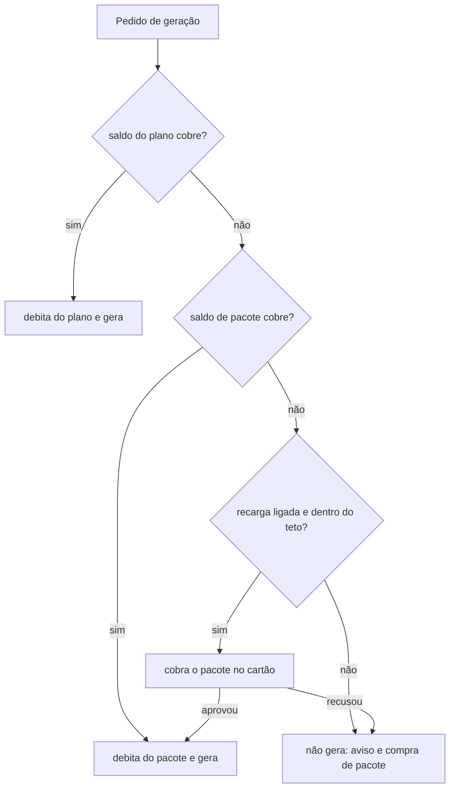

# SPEC 021: planos individual, time e agência, com assinatura de créditos e recarga automática

- **Status:** regras revisadas em 29/10/2026 pela [ADR 0029](../adr/0029-assinatura-com-creditos-e-recarga-automatica.md) (direção aprovada
  pelo Matheus); valores, tabela de créditos, gateway e modelo de agência em aberto
- **Data:** 2026-10-23, revisada em 2026-10-29
- **Cards:** BEZ-135 (cobrança, pai), BEZ-489 (modelo de cobrança), BEZ-301 (cobrança real, adiada), BEZ-265 (modelo de agência)
- **Depende de:** [ADR 0029](../adr/0029-assinatura-com-creditos-e-recarga-automatica.md) (que substitui parte da
  [ADR 0023](../adr/0023-cobranca-por-consumo-com-cartao-obrigatorio.md)), [ADR 0007](../adr/0007-tres-papeis-de-conta.md) (papéis),
  [SPEC 015](015-site-da-ekoai-em-ekoai-com-br.md) (LP), [SPEC 031](031-fatura-e-uso.md) (tela de uso e fatura),
  [SPEC 032](032-preco-por-conta.md) (desconto por conta)
- **Protótipo:** dispensado pelo Matheus em 23/10/2026 para a seção de planos da LP. A tela de saldo, pacotes e recarga volta a pedir
  protótipo quando for feita (entrega 4 da SPEC 031).

## Problema

A LP vendia "Solo" e "Equipe" com 20 posts por mês e preço "R$ XX", e a plataforma não cobra nada (`plans` tem `pessoa` e `inicial`, sem
preço). O custo de cada post é da BEZ e varia de centavos a alguns reais conforme o tipo e o nível de qualidade
([análise de 28/10](../analises/2026-10-28-custo-e-preco-por-post.md)). A versão de 23/10 cobrava depois do uso; a ADR 0029 troca isso por
assinatura com créditos e recarga antes do uso, para a BEZ não gerar sem ter recebido.

## Resultado esperado

1. A LP mostra os três planos com as regras abaixo (hoje desatualizada: mostra Individual a R$ 0 e preço por post, ekoai-website #9).
2. A plataforma cobra a mensalidade, debita créditos a cada geração, recarrega por pacote antes do uso e bloqueia a falta de pagamento
   (BEZ-301, depois da tabela de créditos e do gateway).

**Fora de escopo agora:** integrar gateway, cobrar de verdade, nota fiscal, valores em reais, tela de saldo.

## Regras

### Planos

| Plano | Para quem | Base fixa por mês | Créditos do mês |
| --- | --- | --- | --- |
| Individual | uma pessoa, um perfil | mensalidade do plano (valor aberto) | franquia do plano (valor aberto) |
| Time | quem cria e quem aprova | mensalidade, primeiro usuário grátis, R$ 10 por usuário adicional | franquia (valor aberto) |
| Agência | várias marcas | mensalidade, primeiro usuário grátis, R$ 10 por usuário adicional, R$ 100 por marca | franquia (valor aberto) |

- Os R$ 10 por usuário e os R$ 100 por marca vêm da SPEC de 23/10 e seguem até decisão em contrário. A mensalidade e a franquia de cada
  plano dependem do custo medido (BEZ-260) e ficam em aberto.
- Os créditos são **da conta**, divididos entre todas as pessoas e marcas.
- Entrar no meio do mês paga o mês cheio. Sair vale a partir do mês seguinte.
- O upgrade acontece ao convidar: antes de enviar o convite, aviso "Convidar mais uma pessoa muda seu plano para Time. O primeiro usuário
  continua grátis e cada usuário adicional custa R$ 10 por mês", com os botões "Mudar para Time e convidar" e "Cancelar". Cobra quando o
  convidado aceita. Voltando a 1 usuário, o plano volta a Individual.
- Agência não pode voltar a Time ou Individual enquanto tiver mais de uma marca.

### Créditos

| Regra | Valor |
| --- | --- |
| Unidade | crédito. Cada item gerado debita conforme a tabela por tipo e nível de qualidade (abaixo) |
| Regeneração | debita como uma geração nova |
| Preço do crédito | dois: o do plano e o do pacote de recarga. O do pacote é de **10% a 25% mais caro** (percentual exato em aberto). Não existe crédito avulso fora de um plano |
| Validade do plano | **vence no fim do ciclo e não acumula** |
| Validade do pacote | **não vence e não tem reembolso**: usa até acabar |
| Ordem de consumo | primeiro o saldo do plano (vence), depois o do pacote |
| Falha técnica | estorno automático do crédito (erro nosso, modelo fora do ar, geração que não terminou) |
| Resultado ruim | não estorna |
| Primeiro post | grátis por conta, com cartão válido; um por conta |
| Desconto por conta | SPEC 032, sobre o preço do crédito ou em créditos bônus; nunca aparece para o cliente |

**Tabela de créditos (interna, valores em aberto).** O crédito equivale a um custo fixo da BEZ mais margem, e cada item custa o múltiplo
dele. Estrutura:

| Item | Peso |
| --- | --- |
| Post de texto | a medir |
| Post com layout, sem imagem de IA | a medir |
| Post com imagem de IA | a medir, por nível de imagem |
| Carrossel | base mais um valor por lâmina |
| LinkedIn e X | como o Instagram, mais a publicação (o X cobra por post publicado) |
| Regeneração | o mesmo valor do item |

Os pesos saem do custo real por tipo e nível, lido no Console › Financeiro (SPEC 031, entrega 3). A página pública mostra só exemplos
("250 créditos rendem cerca de N posts com imagem ou M só de texto"), não a tabela inteira.

### Recarga automática

| Situação | O que acontece |
| --- | --- |
| Saldo cobre a geração | debita e gera |
| Saldo não cobre, recarga ligada e dentro do teto | cobra o pacote no cartão e, só se aprovado, libera a geração |
| Cobrança do pacote recusada | não gera; aviso e link para trocar o cartão |
| Recarga desligada ou teto mensal atingido | não gera; aviso e link para ligar a recarga ou comprar pacote |
| Quem liga, desliga e define | só `admin` da conta: liga e desliga, escolhe o pacote e o **teto mensal de recarga** |

Nada fica por cobrar depois: não existe consumo pós-pago. O teto de recarga é o limite de gasto da conta, e ele **bloqueia** (a ADR 0023
chamava o alerta de gasto de "não bloqueante").

### Avisos de saldo

- Aviso quando o saldo total chega a 20% da franquia e quando acaba (proposta; níveis a confirmar), por e-mail e dentro do app.
- Aviso quando a recarga automática cobra um pacote e quando o teto mensal de recarga chega a 80% e a 100%.
- Nome na interface: "saldo", "pacote", "recarga automática" e "teto de recarga". "Limite" só para o teto, que de fato bloqueia.

### Cartão

| Situação | Regra |
| --- | --- |
| Sem cartão | a conta não cria post; a tela explica e leva a cadastrar |
| Cadastro | validado com autorização sem cobrança (3DS quando pedido); cartão recusado não vale |
| Remover o único cartão | desabilitado, com "Adicione outro cartão para remover este" |
| Trocar | adiciona o novo, define como padrão, remove o antigo |
| Encerrar a conta | o saldo de pacote que sobrar se perde, sem reembolso (validar com a advogada) |
| Quem vê e altera | só `admin` da conta |

### Falha de pagamento da mensalidade

| Estado | Acesso | O que acontece |
| --- | --- | --- |
| Ativo | total | n/a |
| Cartão falhou | total | e-mail, aviso no app e novas tentativas durante a carência |
| Bloqueado | somente leitura | ver, exportar, trocar o cartão; nenhum dado é apagado |
| Pagou | total | volta na hora |

## Onde o crédito aparece (decisão pendente)

A decisão de 28/10/2026 diz que nenhuma tela do fluxo de post ou de conexão mostra custo, e a SPEC 032 diz que a tela do cliente não mostra
preço. Crédito pede ao menos o saldo à vista. Opções para o Matheus escolher:

1. **Só o saldo**, no cabeçalho e em Fatura e uso. O fluxo de post não mostra custo por item.
2. **Saldo mais o custo em créditos de cada nível** antes de gerar ("Autoral: 6 créditos"). Mostra créditos, não reais, mas é custo.

Até escolher, vale o que está decidido (opção 1).

## Perguntas abertas

1. **O que debita:** gerar e regenerar debitam. A SPEC 031 lista ajuste, aplicar sugestão, avaliar de novo, tentar de novo a rede e
   regenerar o PDF como "não são posts novos e não geram cobrança". Confirmar que isso continua valendo, ou que algum debita um valor menor.
2. **Valores:** mensalidade e franquia por plano, preço do crédito no plano, percentual do pacote (de 10% a 25%), tamanho dos pacotes e
   teto padrão de recarga. Dependem do custo real (BEZ-260).
3. **Tabela de créditos:** pesos por tipo e nível, a partir do Console › Financeiro.
4. **Carência da mensalidade:** quantas tentativas e quantos dias antes de bloquear (proposta: 3 tentativas em até 7 dias).
5. **Teto de segurança interno** da BEZ contra abuso e cartão roubado, além do teto de recarga do cliente (proposta: invisível no uso normal).
6. **Limite técnico de gerações** por minuto e por dia da conta, só contra robô (proposta: invisível no uso normal).
7. **Marca da agência:** perfil dentro da conta ou conta por cliente (BEZ-265).
8. **Gateway, Pix e nota fiscal:** Asaas está citado em `docs/arquitetura`; falta decidir e conferir cartão recorrente, Pix Automático para a
   mensalidade, Pix pontual para pacote e nota de serviço para CNPJ.
9. **Pacote sem reembolso:** conferir com a advogada o direito de arrependimento em conta de pessoa física.
10. **Crédito bônus** (convidar, indicação, cortesia): fora do escopo; o desconto por conta da SPEC 032 cobre cortesia por enquanto.

## Verificação

- LP: `npm run check` e build no ekoai-website, e a página aberta no navegador em desktop e celular.
- Plataforma (quando houver código): teste que o único cartão não sai, que a geração nunca começa sem saldo ou recarga aprovada, que o
  saldo do plano é consumido antes do de pacote, que o saldo do plano zera no fim do ciclo e o de pacote não, que falha técnica estorna, que o
  primeiro post é grátis uma vez só por conta, que o teto de recarga bloqueia, e que o somente leitura nunca apaga dado.
