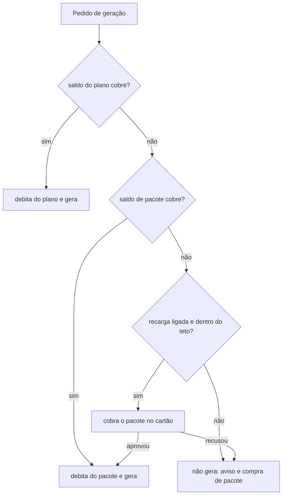

# SPEC 021: planos individual, time e agência, com assinatura de créditos e recarga automática

- **Status:** regras revisadas em 29/10/2026 pela [ADR 0029](../adr/0029-assinatura-com-creditos-e-recarga-automatica.md); planos, preços,
  pacote (R$ 0,60 por crédito), marca extra (R$ 150) e pessoa extra (R$ 10) aprovados pelo Matheus em 29/10/2026; teto de recarga, gateway e impostos em aberto
- **Data:** 2026-10-23, revisada em 2026-10-29
- **Cards:** BEZ-135 (cobrança, pai), BEZ-489 (modelo de cobrança), BEZ-301 (cobrança real, adiada), BEZ-265 (modelo de agência)
- **Depende de:** [ADR 0029](../adr/0029-assinatura-com-creditos-e-recarga-automatica.md) (que substitui parte da
  [ADR 0023](../adr/0023-cobranca-por-consumo-com-cartao-obrigatorio.md)), [ADR 0007](../adr/0007-tres-papeis-de-conta.md) (papéis),
  [SPEC 015](015-site-da-ekoai-em-ekoai-com-br.md) (LP), [SPEC 031](031-fatura-e-uso.md) (tela de uso e fatura),
  [SPEC 032](032-preco-por-conta.md) (desconto por conta)
- **Protótipo:** dispensado pelo Matheus em 23/10/2026 para a seção de planos da LP. A tela de saldo, pacotes e recarga volta a pedir
  protótipo quando for feita (entrega 4 da SPEC 031).

## Problema

A LP vendia "Solo" e "Equipe" com 20 posts por mês e preço "R$ XX", e a plataforma não cobra nada (`plans` tem `pessoa` e `inicial`, sem
preço). O custo de cada post é da BEZ e varia de centavos a alguns reais conforme o tipo e o nível de qualidade
([análise de 28/10](../analises/2026-10-28-custo-e-preco-por-post.md)). A versão de 23/10 cobrava depois do uso; a ADR 0029 troca isso por
assinatura com créditos e recarga antes do uso, para a BEZ não gerar sem ter recebido.

## Resultado esperado

1. A LP mostra os três planos com as regras abaixo (hoje desatualizada: mostra Individual a R$ 0 e preço por post, ekoai-website #9).
2. A plataforma cobra a mensalidade, debita créditos a cada geração, recarrega por pacote antes do uso e bloqueia a falta de pagamento
   (BEZ-301, depois da tabela de créditos e do gateway).

**Fora de escopo agora:** integrar gateway, cobrar de verdade, nota fiscal, valores em reais, tela de saldo.

## Regras

### Planos

Decisão do Matheus em 29/10/2026: quatro planos. O Individual se divide pelo número de redes; o Time inclui **só o dono** e a Agência
inclui **3 pessoas**; cada pessoa a mais custa R$ 10 por mês, em qualquer papel.

| Plano | Para quem | Redes | Pessoas incluídas | Marcas | Créditos por mês | Preço por mês |
| --- | --- | --- | --- | --- | --- | --- |
| Individual, 1 rede | uma pessoa, uma rede (ex.: Instagram) | 1 | 1 (o dono); não aceita mais | 1 | 300 | **R$ 149** |
| Individual, 3 redes | uma pessoa, até três redes | até 3 | 1 (o dono); não aceita mais | 1 | 600 | **R$ 299** |
| Time | uma marca com equipe | até 3 | 1 (o dono) + R$ 10 por pessoa a mais | 1 | 1.200 | **R$ 599** |
| Agência | várias marcas | até 3 por marca | 3 (o dono + 2) + R$ 10 por pessoa a mais | 5 incluídas + R$ 150 por marca extra | 3.500 | **R$ 1.499** |

- **Pessoa a mais: R$ 10 por mês, em qualquer papel** (inclusive quem só vê e aprova), no Time e na Agência. Não custa nada à BEZ (os créditos já estão no plano e são da conta);
  é receita extra e trava contra dividir uma conta entre várias pessoas. Um Time de 5 pessoas custa R$ 599 + 4 × R$ 10 = **R$ 639**; uma
  Agência de 5 pessoas, R$ 1.499 + 2 × R$ 10 = R$ 1.519.
- **Marca extra da Agência: R$ 150 por mês**, sem créditos adicionais (a marca usa o saldo da conta, que é um só).
- **Redes:** o plano limita quantas redes a conta conecta (o banco recusa a conexão além do limite). Quem tenta vê o aviso e o caminho para
  o plano seguinte. O limite vale para toda rede conectada em `social_accounts`; o X entra quando a conexão dele existir. O Individual de
  3 redes só é vendido quando LinkedIn e X estiverem de pé.
- **Créditos são da conta**, divididos entre todas as pessoas e marcas. Gastou o saldo, a geração de **todos** para até o administrador
  recarregar (ver "Recarga automática"): quanto mais a equipe gera, mais rápido o saldo acaba e mais pacotes se vendem.
- Entrar no meio do mês paga o mês cheio. Sair vale a partir do mês seguinte.
- **Upgrade ao convidar:** no Individual, convidar uma segunda pessoa leva ao Time. Antes de enviar o convite, aviso "Convidar mais uma pessoa
  muda seu plano para Time (R$ 599 por mês, 1.200 créditos). Cada pessoa a mais custa R$ 10 por mês", com os botões "Mudar para Time e
  convidar" e "Cancelar". Cobra quando o convidado aceita. Voltando a 1 pessoa, o plano volta ao Individual de antes.
- O salto do Individual (R$ 149 ou R$ 299) para o Time (R$ 599) é grande para quem só quer convidar uma pessoa. Decisão: manter, porque o
  Time vende outra coisa (equipe, revisão, o dobro de créditos). Medir quantos convites ficam parados por causa do preço.
- Agência não pode voltar a Time ou Individual enquanto tiver mais de uma marca.

**Economia por plano** (cada crédito custa R$ 0,0593 à BEZ; reserva de **19% do preço** para imposto, gateway e nota: Simples Nacional perto de
15,5% na primeira faixa do Anexo V, Asaas de 2% a 3,3% no cartão e R$ 0,49 por nota; ver "Imposto e gateway"):

| Plano | Preço | Preço efetivo do crédito | Custo de IA se usar 100% | Lucro se usar 100% | Lucro se usar 70% |
| --- | --- | --- | --- | --- | --- |
| Individual, 1 rede | R$ 149 | R$ 0,50 | R$ 17,79 | R$ 103 (69%) | R$ 108 (73%) |
| Individual, 3 redes | R$ 299 | R$ 0,50 | R$ 35,59 | R$ 207 (69%) | R$ 217 (73%) |
| Time | R$ 599 | R$ 0,50 | R$ 71,17 | R$ 414 (69%) | R$ 435 (73%) |
| Agência | R$ 1.499 | R$ 0,43 | R$ 207,58 | R$ 1.007 (67%) | R$ 1.069 (71%) |

A margem sobe quando o cliente usa menos, porque a mensalidade é fixa e o saldo do plano vence no fim do ciclo. Num mês de 100 clientes (50
no Individual de 1 rede, 25 no de 3 redes, 20 no Time e 5 na Agência, **mistura hipotética**), a receita é R$ 34.400 e o lucro fica em cerca
de R$ 23.600 com uso de 100% (69%) e R$ 24.900 com uso de 70% (72%). Com o Simples no Anexo III (6%, se o fator R passar de 28%), a margem
com uso de 100% sobe para 79%; com a alíquota do Anexo V nas faixas mais altas (cerca de 19,5%) e o cartão a 3,3%, cai para 65%.

### Créditos

| Regra | Valor |
| --- | --- |
| Unidade | crédito. Cada item gerado debita conforme a tabela por tipo e nível de qualidade (abaixo) |
| O que debita | **tudo que custa token ou dinheiro à BEZ**: gerar, regenerar, ajuste, aplicar sugestão, avaliar de novo, tentar de novo a rede, regenerar o PDF e a publicação no X. O peso de cada um vem do custo medido; o que não tem custo mensurável pesa zero |
| Regeneração | debita como uma geração nova |
| Preço do crédito | dois: o do plano e o do pacote de recarga. O do pacote é de **10% a 25% mais caro** (20%, aprovado em 29/10/2026, ver "Preço do crédito"). Não existe crédito avulso fora de um plano |
| Validade do plano | **vence no fim do ciclo e não acumula** |
| Validade do pacote | **não vence e não tem reembolso**: usa até acabar |
| Ordem de consumo | primeiro o saldo do plano (vence), depois o do pacote |
| Falha técnica | estorno automático do crédito (erro nosso, modelo fora do ar, geração que não terminou) |
| Resultado ruim | não estorna |
| Primeiro post | grátis por conta, com cartão válido; um por conta |
| Desconto por conta | SPEC 032, sobre o preço do crédito ou em créditos bônus; nunca aparece para o cliente |

**Tabela de créditos (interna): pesos de partida, a confirmar com o BEZ-490.** O crédito equivale a um custo fixo da BEZ e cada item custa
o múltiplo dele. **Âncora: 1 crédito = US$ 0,01 de custo** (cerca de R$ 0,059 ao câmbio de `pricing.json`, R$ 5,9309). O preço do crédito em
reais, com a margem, é decisão à parte (SPEC 032 e o preço percentual do BEZ-471). Custo medido em 29/10/2026:

| Item | Custo por post (US$) | Origem do número | Créditos |
| --- | --- | --- | --- |
| Rápido, sem imagem de IA | 0,003 | produção, 10 posts do motor atual | 1 (mínimo) |
| Rápido, com imagem de IA | 0,05 a 0,07 | produção, 8 posts; a imagem custou 0,050 em média | 6 |
| Refinado, sem imagem | 0,25 + 0,04 (Cloud Run Job) | eval de 12 pedidos; o Job sai do preço unitário da fatura | 29 |
| Refinado, com imagem Flash | 0,25 + 0,067 + 0,04 | idem | 36 |
| Autoral, sem imagem | 0,56 + 0,04 (Cloud Run Job) | eval de 12 pedidos (tudo Pro); o Job sai do preço unitário da fatura | 60 |
| Autoral, com imagem Pro | 0,56 + 0,135 + 0,04 | idem | 74 |
| Publicação no X | 0,015, ou 0,20 com link | tabela da API do X (docs/analises) | 2 sem link, 20 com link |
| Carrossel | base mais um valor por lâmina | a medir | a medir |
| LinkedIn | como o Instagram | a API não cobra por post (a conferir) | como o Instagram |
| Regeneração | o mesmo custo do item | n/a | o mesmo valor do item |
| Avaliar de novo | cerca de 0,035 (uma chamada do crítico) | palpite, sem medida | 4 |
| Ajuste, aplicar sugestão | cerca de 0,08 a 0,15 (conserto e embelezador) | palpite, sem medida | 8 a 15 |
| Tentar de novo a rede, regenerar o PDF | desprezível | a medir | 0. Tentar de novo depois de falha técnica não cobra duas vezes: a falha foi estornada |

Leitura: do post mais barato ao mais caro o custo varia **cerca de 70 vezes**. Um plano de 250 créditos rende, por exemplo, 250 posts Rápido
sem imagem, 41 com imagem de IA, 6 Refinados com imagem ou 3 Autorais com imagem Pro.

Limites do dado: só o Rápido vem de produção (18 posts de teste, PostHog `post_ready` e `cost_by_step`, sem post novo desde 28/10).
Refinado e Autoral vêm do eval e ainda não rodaram em produção.

Conferido contra a fatura do Google Cloud em 29/10/2026 (export de faturamento, só leitura):

- **Vertex AI do app, com o rótulo `tenant`:** R$ 1,40 em produção, contra cerca de R$ 2,04 registrados (`cost_usd`) nos 18 posts. Estão no
  mesmo patamar. A conferência é aproximada: parte das chamadas do app pode estar sem rótulo, então não dá para dizer que o registro
  superestima ou subestima. O resto do gasto de Vertex em produção (R$ 440 de R$ 442 até 29/10) é de chamadas **sem rótulo**, que pelo
  histórico são evals, juiz e testes, não posts de cliente. Cerca de 57% dele é saída de texto do Pro.
- **Cloud Run Job:** o preço unitário da fatura é R$ 0,000128 por vCPU-segundo e cerca de R$ 0,0000144 por GiB-segundo. Um Job de 2 vCPU e
  4 GiB custa **R$ 0,19 (10 min) a R$ 0,28 (15 min)**, ou US$ 0,032 a 0,048. O US$ 0,04 da tabela (4 créditos) está no meio da faixa.
- **Falta medir:** Refinado e Autoral de verdade (só depois de o estúdio rodar em produção), ajuste, avaliar de novo e PDF.

Taxa do gateway e imposto não entram nos pesos: são custo da venda e entram na reserva de 19% acima.

Os pesos finais saem do custo real por tipo e nível, lido no Console › Financeiro (SPEC 031, entrega 3). A página pública mostra só
exemplos ("250 créditos rendem cerca de N posts com imagem ou M só de texto"), não a tabela inteira.

### Preço do crédito (aprovado em 29/10/2026)

Custo de um crédito: US$ 0,01, ou **R$ 0,0593** (câmbio de `pricing.json`). Como o preço de cada plano é fechado (tabela acima), o preço do
crédito dentro do plano é o preço dividido pelos créditos: **R$ 0,50** no Individual e no Time, **R$ 0,43** na Agência. O de pacote segue a
regra de 10% a 25% acima do plano:

| Onde | Preço do crédito | Como sai |
| --- | --- | --- |
| No plano (Individual e Time) | R$ 0,50 | 8,4 vezes o custo, margem de 88% |
| No pacote de recarga | **R$ 0,60** | 20% acima do plano de R$ 0,50, margem de 90% |

Pacotes de exemplo (tamanho a definir): 100 créditos por R$ 60, 250 por R$ 150, 500 por R$ 300. Um pacote de 100 créditos cobre um post
Autoral com imagem Pro (74).

Quanto custa cada item ao cliente, ao preço efetivo do plano (R$ 0,50 por crédito):

| Item | Créditos | Preço | Custo da BEZ |
| --- | --- | --- | --- |
| Rápido, sem imagem de IA | 1 | R$ 0,50 | R$ 0,06 |
| Rápido, com imagem de IA | 6 | R$ 3,00 | R$ 0,36 |
| Refinado, sem imagem | 29 | R$ 14,50 | R$ 1,72 |
| Refinado, com imagem Flash | 36 | R$ 18,00 | R$ 2,14 |
| Autoral, sem imagem | 60 | R$ 30,00 | R$ 3,56 |
| Autoral, com imagem Pro | 74 | R$ 37,00 | R$ 4,39 |
| Publicação no X, sem link ou com link | 2 ou 20 | R$ 1,00 ou R$ 10,00 | R$ 0,09 ou R$ 1,19 |
| Avaliar de novo | 4 | R$ 2,00 | R$ 0,21 |

- **Imposto e gateway (levantado em 29/10/2026):** as margens da tabela de itens são antes de imposto, gateway e nota. Imposto: Simples
  Nacional, perto de 15,5% na primeira faixa do Anexo V (sem fator R) e perto de 6% no Anexo III (com fator R acima de 28%); as faixas
  seguintes cobram mais. **O contador confirma o anexo e a alíquota.** Gateway (Asaas, página de preços, sem data, conferir em Menu do
  usuário > Taxas): cartão de R$ 0,49 + 1,99% a 2,99% por cobrança (a página mostra dois valores e não diz qual é o promocional de 3
  meses), Pix de R$ 0,79 a R$ 1,99 por recebimento e nota fiscal de R$ 0,49. Sobre uma mensalidade de R$ 149 isso é de 2,3% a 3,3%; sobre
  R$ 599, de 2,1% a 3,1%.
- **Comparação:** ao preço do plano, o Autoral com imagem Pro custa R$ 37 e o Refinado com imagem R$ 18, abaixo de R$ 40 a R$ 290 por post em
  agência ou freelancer (análise de 28/10, não verificada de forma independente). O preço é uma aposta de mercado: o Individual de R$ 149
  fica bem acima de ferramentas de agendamento (na análise de 16/10, o mLabs ancora em cerca de R$ 30 por marca), e o que justifica a
  diferença é o post gerado e desenhado por IA.
- **Primeiro post grátis (proposta):** vale em qualquer nível até o Refinado, uma vez por conta. Custa à BEZ até cerca de R$ 2,14 e é o nível
  que mostra a qualidade do produto.
- **Não foi configurado nada:** a política de preço do console (`platform_pricing`) segue como está até o Matheus aprovar.

### Recarga automática

| Situação | O que acontece |
| --- | --- |
| Saldo cobre a geração | debita e gera |
| Saldo não cobre, recarga ligada e dentro do teto | cobra o pacote no cartão e, só se aprovado, libera a geração |
| Cobrança do pacote recusada | não gera; aviso e link para trocar o cartão |
| Recarga desligada ou teto mensal atingido | não gera; aviso e link para ligar a recarga ou comprar pacote |
| Quem liga, desliga e define | só `admin` da conta: liga e desliga, escolhe o pacote e o **teto mensal de recarga** |
| Valores padrão (proposta) | teto mensal de recarga igual ao preço do plano; pacote de 100 créditos no Individual, 250 no Time e 500 na Agência. A recarga já vem **desligada** até o administrador ligar, para ninguém ser cobrado sem ter escolhido |
| Pessoa sem papel de administrador, saldo zerado | não gera; aviso "O saldo de créditos da conta acabou. Peça ao administrador para ligar a recarga ou comprar um pacote." |

Nada fica por cobrar depois: não existe consumo pós-pago. O teto de recarga é o limite de gasto da conta, e ele **bloqueia** (a ADR 0023
chamava o alerta de gasto de "não bloqueante").

### Avisos de saldo

- Aviso quando o saldo total chega a 20% da franquia e quando acaba (proposta; níveis a confirmar), por e-mail e dentro do app.
- Aviso quando a recarga automática cobra um pacote e quando o teto mensal de recarga chega a 80% e a 100%.
- Nome na interface: "saldo", "pacote", "recarga automática" e "teto de recarga". "Limite" só para o teto, que de fato bloqueia.

### Cartão

| Situação | Regra |
| --- | --- |
| Sem cartão | a conta não cria post; a tela explica e leva a cadastrar |
| Cadastro | validado com autorização sem cobrança (3DS quando pedido); cartão recusado não vale |
| Remover o único cartão | desabilitado, com "Adicione outro cartão para remover este" |
| Trocar | adiciona o novo, define como padrão, remove o antigo |
| Encerrar a conta | o saldo de pacote que sobrar se perde, sem reembolso (validar com a advogada) |
| Quem vê e altera | só `admin` da conta |

### Falha de pagamento da mensalidade

| Estado | Acesso | O que acontece |
| --- | --- | --- |
| Ativo | total | n/a |
| Cartão falhou | total | e-mail, aviso no app e novas tentativas durante a carência |
| Bloqueado | somente leitura | ver, exportar, trocar o cartão; nenhum dado é apagado |
| Pagou | total | volta na hora |

## Onde o crédito aparece

**Decidido pelo Matheus em 29/10/2026: só o saldo, em Configurações › Fatura e uso.** O fluxo de post e a conexão não mostram custo nem
saldo, o que mantém a decisão de 28/10/2026 e a da SPEC 032 (o cliente não vê preço). O custo em créditos de cada nível antes de gerar
ficou de fora.

## Perguntas abertas

1. **Aviso de saldo sem mostrar o saldo no fluxo de post:** como a pessoa sabe que o saldo está acabando, se só Fatura e uso mostra? Os
   avisos por e-mail e dentro do app (acima) cobrem; confirmar o texto e onde o aviso aparece sem virar "custo no fluxo".
2. **Valores padrão da recarga:** o preço do pacote (R$ 0,60 por crédito, 20% acima do plano) e os tamanhos (100, 250 e 500 créditos)
   foram aprovados em 29/10/2026. Proposta, a confirmar: teto mensal de recarga igual ao preço do plano (a conta paga no máximo o dobro da
   mensalidade) e recarga desligada por padrão. Pesos a conferir com o custo real (BEZ-490).
3. **Tabela de créditos:** os pesos de partida estão na tabela acima; confirmar os de Refinado e Autoral com a medida em produção, e medir carrossel, ajuste,
   avaliar de novo, X, Cloud Run Job e PDF (BEZ-490).
4. **Carência da mensalidade:** quantas tentativas e quantos dias antes de bloquear (proposta: 3 tentativas em até 7 dias).
5. **Teto de segurança interno** da BEZ contra abuso e cartão roubado, além do teto de recarga do cliente (proposta: invisível no uso normal).
6. **Limite técnico de gerações** por minuto e por dia da conta, só contra robô (proposta: invisível no uso normal).
7. **Marca da agência:** perfil dentro da conta ou conta por cliente (BEZ-265).
8. **Gateway, Pix e nota fiscal:** Asaas está citado em `docs/arquitetura` e a taxa foi levantada (ver "Imposto e gateway"). Falta decidir o
   gateway, abrir a conta, conferir as taxas do contrato, ver o Pix Automático para a mensalidade (a página de preços não traz taxa) e a nota
   de serviço (NFS-e).
9. **Pacote sem reembolso (regra do produto decidida):** quem compra pacote usa os créditos dentro da plataforma, sem devolução. Só falta
   conferir com a advogada se a lei de defesa do consumidor (direito de arrependimento em compra online, 7 dias) obriga a devolver em
   conta de pessoa física, e como escrever o termo. Para empresa (CNPJ) a regra não se aplica do mesmo jeito.
10. **Crédito bônus** (convidar, indicação, cortesia): fora do escopo; o desconto por conta da SPEC 032 cobre cortesia por enquanto.

11. **Limite de redes por plano:** decidido e em implementação (`plans.max_networks` e gatilho no banco). Falta a troca de plano pela
    própria pessoa (Individual de 1 rede para 3 redes), que hoje só o console faz.

## Verificação

- LP: `npm run check` e build no ekoai-website, e a página aberta no navegador em desktop e celular.
- Plataforma (quando houver código): teste que o único cartão não sai, que a geração nunca começa sem saldo ou recarga aprovada, que o
  saldo do plano é consumido antes do de pacote, que o saldo do plano zera no fim do ciclo e o de pacote não, que falha técnica estorna, que o
  ajuste, avaliar de novo e regenerar debitam o peso da tabela, o primeiro post é grátis uma vez só por conta, que o teto de recarga bloqueia, e que o somente leitura nunca apaga dado.
