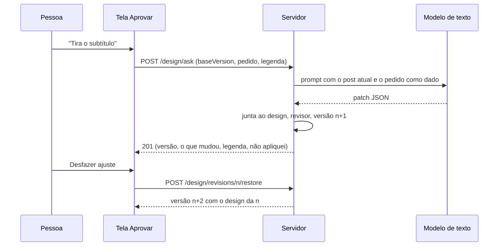

# SPEC 024: pedir ajuste em texto livre e Estúdio de edição do post

- **Status:** entrega a (pedir ajuste) na staging (PR #195); entrega b-E1 (Estúdio) implementada em 26/10/2026 com as decisões 10, 11 e 13 resolvidas; E2 a E4 seguem em card
- **Data:** 2026-10-23
- **Cards:** BEZ-193 (entrega a), BEZ-196 (entrega b, com os filhos BEZ-315 a BEZ-318)
- **Depende de:** [SPEC 019](019-estudio-incremental-e-aprendizado-com-a-edicao.md) (revisão imutável, conflito de versão,
  revisor depois da edição, regra de marca), [SPEC 012](012-agentes-instagram-fase-2.md) (motor híbrido, revisor por regra),
  [ADR 0021](../adr/0021-revisao-imutavel-com-diff-por-campo.md) e [ADR 0022](../adr/0022-instrucao-do-pedido-lida-em-contrato-fechado-e-obedecida-por-codigo.md)
  (o modelo devolve contrato fechado, o código obedece)
- **Reaproveita:** o ajuste rápido da SPEC 019 (`previewEdit`, `saveEdit`, `restoreVersion`, `parseEditable`)
- **Protótipo:** v9 do artifact da Ekoai (https://claude.ai/artifact/55avs7vhgtwKFn9HMAR9Fz), aprovado em 21/10/2026. Em **Aprovar**,
  os estados "Pedir ajuste: texto escrito, aplicando, antes e depois, pede visual novo, não deu para aplicar". Na tela **Estúdio**,
  os 10 estados (entrada, título, mais cores, círculo, logo, post sem logo, fundo em cor, atmosfera, revisor travando duas vezes).

## Problema

1. **Quem quer mudar uma coisa precisa achar o campo.** O ajuste rápido da SPEC 019 tem campos fixos (título, subtítulo, cor do
   título, canto do logo, layout). "Tira o nome repetido do rodapé" ou "deixa só os 3 itens" obrigam a conhecer a tela. Os atalhos
   de legenda (Encurtar, Mais descontraído) só mexem na legenda.
2. **O post pequeno em Aprovar não serve para edição funda.** A moldura do feed cabe numa coluna; quem quer mexer em vários
   elementos precisa de imagem grande, lista de elementos e propriedades lado a lado (BEZ-196).

## Resultado esperado

**a. Pedir ajuste (BEZ-193).** A pessoa escreve o que mudar e, se quiser, onde (texto da imagem, legenda, layout, visual). Só isso
muda, o resto fica idêntico. Aparece o antes e depois e dá para desfazer. Não chama o modelo de imagem e não gasta do limite do mês.

**b. Estúdio (BEZ-196).** "Editar imagem" abre uma tela própria com a imagem grande, a lista de elementos à esquerda e as
propriedades à direita, com desfazer, refazer, Restaurar padrão, versões e o mesmo "Pedir à Ekoai" da entrega a.

## Decisões (recomendação em negrito; **(Matheus)** pede confirmação)

**Entrega a (implementada)**

1. **O modelo devolve um patch, nunca o post inteiro.** O contrato é fechado (`image.layout`, `image.texts`, `image.logoCorner`,
   `image.logoHidden`, `image.colors`, `caption`, `needsVisual`, `notApplied`); o resto é descartado. Quem junta o patch ao design da
   versão em uso é o código, então o que o pedido não citou fica idêntico **por construção**, não por confiança no modelo.
2. **A gravação passa pela via do Confirmar** (`saveEdit`): mesmo revisor, mesma checagem de versão (409), mesma regra de
   contraste e margem (422). O pedido aplicado vira uma versão (`source = edit`), sem migration. **Desfazer = restaurar a versão
   anterior**, que cria uma versão nova e não apaga nenhuma.
3. **A legenda não grava nada no servidor.** O patch de legenda passa pelo revisor do atalho de legenda (palavra proibida, nunca
   afirmar, número fora dos fatos) e a tela só o coloca no campo; vale quando a pessoa aprova.
4. **Visual novo não é feito aqui.** "Visual" (ou `needsVisual`) avisa que gera o post de novo e conta 1 no limite, e leva a
   "Outra direção" (que já existe). Trocar só o fundo mantendo o texto exige tocar a geração e fica em card próprio.
5. **O pedido é dado, não instrução** ([ADR 0022](../adr/0022-instrucao-do-pedido-lida-em-contrato-fechado-e-obedecida-por-codigo.md)):
   vai ao modelo entre aspas triplas, e nada dentro dele cria chave, muda regra do revisor ou o formato da resposta.
6. **O que não coube aparece, nunca some em silêncio.** `notApplied` (o que foi pedido e por que não deu) é mostrado; se nada
   foi aplicado, o erro diz o motivo.
7. **Custo.** Uma chamada de texto por pedido, reservada em `generation_runs` (passo `writer`, idempotente pelo hash do prompt:
   o mesmo pedido sobre a mesma versão não cobra de novo). Limite de 30 pedidos por hora por conta. Só `content.edit`.
8. **Rodapé** do protótipo (nome ou @ no pé do post) só existe na família `marca` da SPEC 020 (BEZ-294, PR #185): entra no
   contrato quando ela chegar. Hoje o pedido sobre o rodapé volta como "não apliquei".
9. **Medição sem texto.** Evento `design_ask` com aspecto, resultado, campos mudados e `model_calls`; nunca o pedido nem o antes
   e depois (`sanitizeProps` continua valendo).

**Entrega b (Estúdio), decidida pelo Matheus em 26/10/2026**

10. **Gatilho da fase 3 da SPEC 019 liberado.** O Estúdio completo estava condicionado a dado (5 contas, 25% de descarte ou 20% de
    desejo de mover). Ele mandou fazer agora; os eventos `design_edit_wish` seguem medindo e decidem a ordem entre E3 e E4, não se o
    Estúdio existe.
11. **O Estúdio substitui o painel de ajuste rápido.** Em Aprovar fica só o card **Imagem** (versão em uso, resumo e o botão
    **Editar imagem**; **Ver versões** para o leitor). Texto, cor, logo, layout, versões, desfazer, refazer e Padrão moram no Estúdio.
    As mesmas rotas e o mesmo desenho do servidor valem nos dois. O "Pedir ajuste" em texto livre continua em Aprovar (legenda
    fica lá) e aparece no Estúdio como **Pedir à Ekoai**, só para imagem.
12. **Quatro entregas, na ordem:** E1 tela própria só com o que o motor já faz (BEZ-315, esta PR); E2 tamanho do texto, fonte da lista
    curada, formato e fundo liso, com campos novos no design (BEZ-316); E3 posição em grade 3x3 e arrastar (BEZ-317, junto do BEZ-194);
    E4 variações do logo e foto própria no post de atmosfera (BEZ-318).
13. **Implementar e melhorar depois.** O círculo do protótipo v9 não existe no motor e não entra; o E1 usa o que o motor tem.
    "Mover elementos" volta como reposição dos slots reais no E3.
14. **Nada no Estúdio chama o modelo de imagem**, exceto "Gerar outro visual" (conta no limite, como hoje; o E1 leva a Outra direção).

**E1 (implementado).** Rota `/aprovar/[pendingId]/estudio`, em tela cheia (sem a barra lateral do app). Elementos: Título, Selo,
Subtítulo, Itens (na lista numerada), Logo (canto, esconder) e Layout (miniaturas do servidor). Cor própria para título, selo,
subtítulo e itens, com o contraste medido (o revisor trava abaixo do mínimo). Itens editáveis, com até 4. No celular os elementos viram
chips acima do painel e as ações vão para a barra de baixo. Leitor vê só as versões. A frase de "o que mudou" na tela é igual à que
o servidor grava, item por item e por cor de cada texto (teste).

## Contrato do patch (entrega a)

```ts
type AskResult = {
  image?: {
    layout?: Layout;                         // só um dos compatíveis com o post
    texts?: { kicker?: string | null; title?: string; sub?: string | null; items?: string[] | null }; // null remove
    logoCorner?: 'tl' | 'tr' | 'bl' | 'br';
    logoHidden?: boolean;
    colors?: Partial<Record<'title' | 'sub' | 'kicker' | 'items', string | null>>; // #RRGGBB; null volta à marca
  };
  caption?: { caption?: string; hashtags?: string[] };
  needsVisual?: boolean;
  notApplied?: { what: string; why: string }[];   // até 5
};
```

Parser puro em `platform/src/lib/design/ask-model.ts`: nunca lança, descarta chave fora da lista e entrega o design inteiro a
`parseEditable` (a mesma validação do ajuste rápido). Resposta fora do contrato vira "não apliquei".



| Rota | Permissão | Corpo | Respostas |
| --- | --- | --- | --- |
| `POST /api/posts/[id]/design/ask` | `content.edit` | `baseVersion`, `instruction` (até 500), `aspect` opcional, `caption`, `hashtags` | 201 versão gravada; 200 só legenda ou visual novo; 400 corpo inválido ou nada a aplicar; 409 versão velha; 422 revisor barrou; 429 excesso |

## Requisitos da entrega a

- **R1.** Corpo validado na entrada (`parseAskBody`) antes de qualquer leitura; pedido vazio ou acima de 500 caracteres: 400 com o campo.
- **R2.** Versão da tela diferente da em uso: 409 com quem salvou e o resumo, **sem chamar o modelo**.
- **R3.** Aspecto "Visual": nenhuma chamada de modelo, nenhuma gravação, aviso do limite.
- **R4.** Campo não citado no pedido fica idêntico (comparação do `texts` e dos demais campos antes e depois, no banco).
- **R5.** O revisor barra cor sem contraste: 422, nada gravado, a versão em uso continua a mesma.
- **R6.** Mesmo pedido sobre a mesma versão: o modelo não é chamado de novo.
- **R7.** Leitor não vê o campo e a API devolve 403; conta A não pede ajuste no post da conta B (404).
- **R8.** Mudança do painel de ajuste rápido ainda não confirmada trava o campo, para o pedido não passar por cima dela.

## Verificação

- **Unitários** (`tests/design-ask-model.test.js`): parser do corpo e do patch, chave fora da lista, valores fora da regra, patch
  sem mudança, legenda, prompt com o pedido delimitado.
- **Rota e serviço** (`tests/design-ask-routes.test.js`): permissão, 400/404/409/422/429, aspecto Visual sem modelo, legenda com
  palavra proibida, nada aplicável, mesmo pedido sem nova chamada, evento sem texto.
- **Banco** (`tests/db/design-ask.integration.test.js`, Postgres real): versão 2 com só o subtítulo mudado, sem modelo de imagem e
  sem tocar `generation_runs` de visual, reserva idempotente, desfazer, revisor, isolamento entre contas, post decidido.
- **Navegador:** `e2e/tests/post-ask.spec.ts` (CI, com o emulador de login). Localmente, o mesmo fluxo rodou no Chrome contra o app
  em modo dev, o banco e um servidor de modelo simulado, em desktop e mobile.
- **Não coberto:** modelo de texto real (Vertex). A qualidade da leitura do pedido pelo Gemini precisa de eval próprio
  (`evals/`), a fazer com o primeiro uso real.

## Entregas

| # | Entrega | Verificação | Card |
| --- | --- | --- | --- |
| 0 | Esta spec | Revisão do Matheus | BEZ-193 |
| a | Pedir ajuste: parser, serviço, rota, tela, evento | Critérios R1 a R8 | BEZ-193 |
| b-E1 | Estúdio: tela própria sobre o que o motor já faz | Prints, E2E (24 casos), sem modelo de imagem | BEZ-315 |
| b-E2 | Tamanho do texto, fonte, formato e fundo liso | Parser, revisor, render | BEZ-316 |
| b-E3 | Posição em grade e arrastar | A definir com a SPEC 020 | BEZ-317 |
| b-E4 | Variações do logo e foto própria | Depende do BEZ-209 | BEZ-318 |

## Riscos

| Risco | Efeito | Mitigação |
| --- | --- | --- |
| O Gemini lê mal o pedido e devolve patch errado | Versão com mudança que ninguém pediu | A pessoa vê o antes e depois e desfaz com um clique; o revisor barra o pior; eval de leitura no primeiro uso real |
| Pedido com instrução ao sistema | Tentativa de mudar regra ou formato | Contrato fechado, pedido como dado, parser descarta chave desconhecida |
| Muitas versões por pedido | Passa de 20 revisões | A regra de `prune` da SPEC 019 já mantém 20 e preserva a v1 e a em uso |
| Estúdio e painel divergem | Dois jeitos de editar com comportamentos diferentes | Mesmas rotas e mesmo servidor; decisão 11 |
