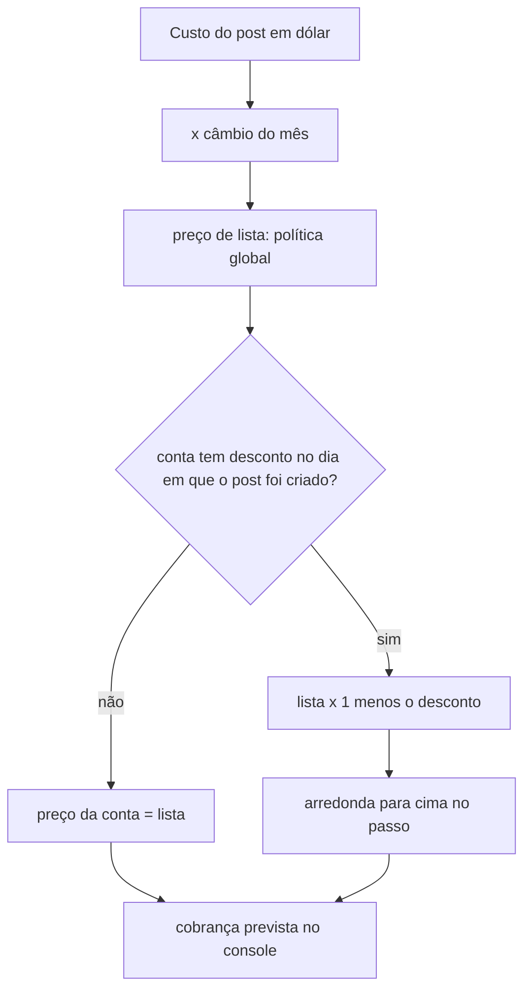

# SPEC 032: Desconto de preço por conta

- **Status:** proposta, em construção
- **Data:** 2026-10-30
- **Cards:** BEZ-473 (esta spec); BEZ-301 (cobrança real, congela o preço cobrado); BEZ-472 (valor cobrado na fatura do cliente)
- **Depende de:** [SPEC 031](031-fatura-e-uso.md) (política de preço em `platform_pricing`, Console › Financeiro) e
  [ADR 0023](../adr/0023-cobranca-por-consumo-com-cartao-obrigatorio.md)

## Problema

A política de preço é uma só para a plataforma inteira. Falta o caso comum de vendas: dar um desconto a uma conta (piloto, cliente grande,
cortesia) sem mexer em código e sem baixar o preço de todo mundo. O desconto também não pode aparecer para o cliente: o preço de cada conta
varia, então a tela do cliente não mostra preço (decisão de 30/10/2026).

## Decisão

1. **Um desconto percentual sobre o preço de lista.** Preço da conta = preço de lista do post (política global) menos o desconto, arredondado
   para cima no mesmo passo. Não há "percentual próprio" por conta: dois jeitos de dizer a mesma coisa confundem. O pedido do cliente é "10%
   mais barato", e isso mantém o preço de lista intacto.
2. **O desconto tem período.** Começa no dia em que é aplicado e termina numa data opcional. Cada post usa o desconto que valia no dia em que
   foi criado. Mudar o desconto nunca reescreve o preço de posts de períodos anteriores: a linha antiga é encerrada, não editada.
3. **Motivo obrigatório.** Todo desconto diz por que existe (de 3 a 200 caracteres).
4. **Só no console.** A tabela `account_price_discounts` não tem política de RLS (só o servidor lê) e a coluna da conta chama-se `account_id`,
   não `tenant_id`, de propósito: tabela com `tenant_id` entra em `TENANT_TABLES` e portanto na exportação de dados que o cliente baixa
   (LGPD), e o desconto não pode sair por ali.
5. **Aviso, não bloqueio.** O console mostra, ao definir o desconto, o preço e a margem de posts de exemplo e avisa quando fica abaixo da meta
   ou abaixo do custo. A decisão é da administradora da plataforma.
6. **Auditoria sem valores.** `console.account_discount_set` e `console.account_discount_ended` com a conta como alvo e sem tenant, para
   o registro de atividade da conta não mostrar o desconto ao cliente.

Fora desta spec: congelar o preço cobrado em cada post (nasce com a cobrança real, BEZ-301, junto da fatura emitida; a política global também
muda sem histórico, então a cobrança prevista do console é uma estimativa recalculada) e mostrar valor ao cliente (BEZ-472).

## Como fica no console

Console › Financeiro › uma conta, no alto: **Preço desta conta**. Mostra o desconto ativo (percentual, desde quando, até quando, motivo) ou
"Sem desconto". Campos: desconto (%), motivo, vence em (opcional). Botões: **Aplicar desconto** (encerra o anterior e começa este hoje) e
**Encerrar desconto**. Abaixo, o histórico de descontos da conta. Na lista de contas, uma etiqueta "desconto 10%" ao lado do nome. A
cobrança prevista e o lucro da conta e de cada post já usam o desconto.

## Dados

`account_price_discounts`: `id`, `account_id` (conta, apaga junto), `discount_percent` (maior que 0 e até 100), `reason`, `starts_on`,
`ends_on` (opcional, nunca antes de `starts_on`), `created_at`, `created_by`. Sem política de RLS; só o `service_role` lê e grava.

## Critérios de aceite

1. O desconto aplicado muda a cobrança prevista só daquela conta, nos posts criados dentro do período.
2. Desconto vencido ou encerrado deixa de valer para posts novos e mantém o preço dos posts do período.
3. Aplicar um novo desconto encerra o anterior e deixa um só ativo.
4. A tabela não tem política de RLS e não está em `TENANT_TABLES`; a exportação de dados da conta não traz o desconto.
5. A auditoria registra a mudança sem valores e sem tenant.
6. Nenhuma tela nem API de cliente recebe desconto, custo, margem ou percentual.
