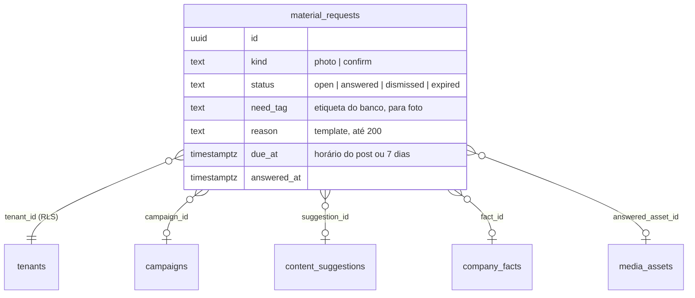

# SPEC 036: a Ekoai pede o material que falta para o post

- **Status:** na `staging` desde 04/11/2026 (PR #348, com o servidor da #347 e a migration 0064); protótipo v31 aprovado em
  04/11/2026. Falta a release
- **Data:** 2026-11-04
- **Cards:** BEZ-549 (esta spec); pai BEZ-542 (roadmap AI-native)
- **Origem:** EKO-16 em [`docs/analises/2026-11-03-documentacao-mestra-ai-native.md`](../analises/2026-11-03-documentacao-mestra-ai-native.md) (seções 13 e 17.4)
- **Depende de:** coordenador de conteúdo e sugestões (SPEC 017, `content_suggestions`, `content-plan-model.ts`), banco de imagens
  (`media_assets`, consentimento de uso de imagem), fatos com validade e campanhas (SPEC 018), conferência antes de publicar (BEZ-275)

## Problema

1. O coordenador sugere "Mostrar o produto" para a campanha, mas o banco não tem foto do produto que possa ser usada. O post sai com o
   layout da marca, sem prova real, e ninguém pede a foto.
2. O post da campanha vai afirmar uma oferta que vence em dois dias ou que ainda está para revisar. A pessoa só descobre quando a
   conferência antes de publicar segura o post (BEZ-275), na hora de sair.
3. Quando a pessoa sobe uma foto, ela cai no banco sem contexto: ninguém sabe para que post ela foi pedida.

## O que muda para a pessoa

Em Início, um cartão "A Ekoai precisa de você" mostra no máximo dois pedidos pequenos, cada um com o motivo e o post que ele destrava:

- **Foto:** "Mande 1 ou 2 fotos da caixa de panetone para o post de sábado. Com foto real, o post mostra o produto que a pessoa vai
  receber." A pessoa envia do celular ou escolhe do banco, ou diz "Não tenho agora".
- **Confirmar:** "A caixa de panetone continua R$ 89 até 15/12? O post de sábado diz esse preço." Sim, mudou (corrige ali) ou não
  vale mais.

Respondido, o pedido some e a sugestão ligada passa a usar a foto ou o fato confirmado.

## Decisões propostas (o Matheus confirma no protótipo)

1. **Dois tipos na v1:** foto e confirmação de fato. Vídeo, depoimento e áudio ficam de fora (Reels sem decisão, BEZ-421; depoimento
   tem risco de ser inventado).
2. **Quem cria é a regra, não o modelo.** Na rodada do coordenador (sem custo de IA): pede **foto** quando a sugestão é de um objetivo
   que pede foto real (produto, bastidores, equipe, espaço, evento) e o banco não tem foto sugerível com a etiqueta; pede
   **confirmação** quando há sugestão de campanha nos próximos dias e um fato confirmado de preço ou prazo vence em até 7
   dias. Fato para revisar não entra: a geração só usa fato confirmado e vigente, então ele não chega ao post. O motivo sai de um
   template, como o das sugestões.
3. **Pouco e com prazo:** no máximo 2 pedidos abertos por conta e 1 novo por rodada. Cada pedido vence no horário do post ligado
   (ou em 7 dias). Um aviso quando nasce e um lembrete 24 h antes de vencer; nada de aviso diário.
4. **"Não tenho agora"** dispensa o pedido: a sugestão segue com o layout da marca e a Ekoai não pede a mesma coisa por 14 dias.
   Vencido vira o mesmo caso, sem culpa na tela.
5. **A resposta vai para onde já existe:** a foto entra no banco com a etiqueta pedida, a descrição da visão que já existe e a
   pergunta de autorização de uso de imagem quando mostra pessoas (sem autorização, não entra no post). A confirmação usa as ações
   dos fatos (confirmar, corrigir, desligar) com as mesmas permissões.
6. **Quem vê:** quem cria ou aprova post vê e responde pedido de foto; confirmar fato exige quem gerencia a marca. Quem só acompanha
   não vê o cartão.
7. **Na campanha:** o detalhe da campanha lista os pedidos dela (aberto, recebido, dispensado, vencido), para a pessoa ver o que
   falta sem abrir Início.

## Protótipo (obrigatório antes de codar)

Versão 31 (`version_id` 1793789409-4ee0) do artifact único da Ekoai, https://claude.ai/artifact/55avs7vhgtwKFn9HMAR9Fz, grupo
"Fase 14: pedido de material (SPEC 036)". Telas, em desktop e celular:

- **Início: a Ekoai precisa de você:** dois pedidos, um vencendo hoje, sem pedido, carregando e falha ao carregar.
- **Pedido: enviar fotos:** aberto, enviando, recebida, com pessoas (autorização de uso de imagem), falha ao enviar, não tenho agora e
  vencido.
- **Pedido: confirmar um fato:** pergunta, o preço mudou, confirmado, não vale mais e sem permissão para confirmar.
- **Campanha: pedidos de material:** com pedidos e vazio.

Fonte em `.context/proto-036` do workspace (`phase14.js`, `phase14.css`, `build.py` sobre a v30). Aprovado em 04/11/2026.

## Modelo de dados

Restrições: no máximo 2 `open` por conta (índice parcial e checagem na criação), `kind = 'confirm'` exige `fact_id`, `kind =
'photo'` exige `need_tag`. A tabela entra em `TENANT_TABLES` com RLS.

## Divisão em PRs

- **a (servidor):** migration 0064 (`material_requests`), regra pura em `lib/material-request-model.ts`, criação no fim da rodada do
  coordenador, vencimento e lembrete na mesma rodada, rotas `GET /api/material-requests` e `POST
  /api/material-requests/[id]/{photo,dismiss,confirm}`, eventos.
- **b (tela):** cartão em Início, páginas do pedido (enviar fotos, confirmar fato) e cartão na campanha, como no protótipo v31.

## Fora de escopo

Pedir pelo WhatsApp ou e-mail (só Início e o aviso no app), pedido criado pelo modelo, vídeo e depoimento, e pedido sem post ligado.

## Aceite

- Sugestão de produto sem foto no banco gera um pedido de foto com motivo; com foto sugerível, não gera.
- Nunca há mais de 2 pedidos abertos; "Não tenho agora" segura o mesmo pedido por 14 dias.
- Foto enviada pelo pedido entra no banco com a etiqueta e a sugestão passa a usá-la; com pessoas e sem autorização, não entra no post.
- Confirmar, corrigir ou desligar pelo pedido muda o fato como a tela de fatos muda.
- Evento `material_requested` e `material_answered` (tipo, resultado, tempo até responder), sem texto do pedido.
- Protótipo aprovado antes do código de tela (desktop e celular; vazio, carregando, erro e cheio).
