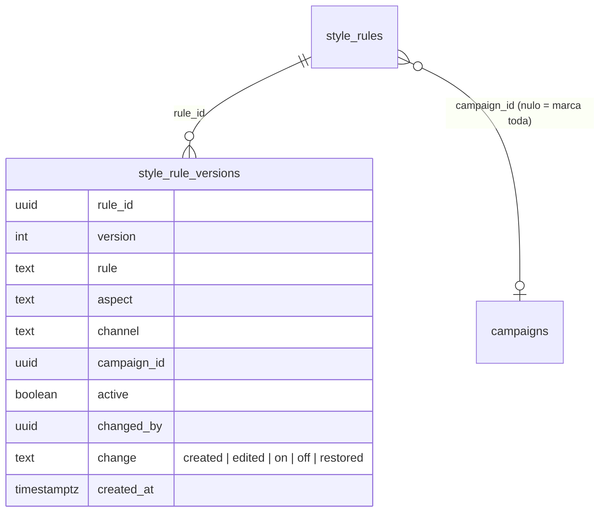

# SPEC 037: regras da marca com escopo (campanha ou marca) e versão

- **Status:** protótipo v32 aprovado pelo Matheus em 04/11/2026; implementado na PR do BEZ-547 (migration 0065)
- **Data:** 2026-11-04
- **Cards:** BEZ-547 (esta spec); pai BEZ-542 (roadmap AI-native)
- **Origem:** EKO-09 em [`docs/analises/2026-11-03-documentacao-mestra-ai-native.md`](../analises/2026-11-03-documentacao-mestra-ai-native.md) (seções 7.2, 7.5 e 11.9)
- **Depende de:** regras de texto e tom (`style_rules`, `lib/feedback.ts`, `components/RulesEditor.tsx`), campanhas (SPEC 018), geração
  (`lib/generation.ts`, `lib/studio/generate.ts`, `lib/photo-post.ts`, `lib/engage.ts`)

## Problema

1. Toda regra vale para a marca inteira. "Tom mais festivo e com contagem regressiva" serve à campanha de fim de ano, mas hoje
   entra em todo post, também depois que a campanha acaba. O plano pede que preferência de campanha não mude a identidade da marca.
2. Editar uma regra sobrescreve o texto anterior. Ninguém vê como ela era nem consegue voltar.
3. A tela "Texto e tom" diz que "toda semana a revisão refaz as regras que vieram das suas edições e feedbacks". Essa revisão não
   existe na plataforma: hoje toda regra é manual. O texto promete o que o produto não faz.

## O que muda para a pessoa

- Ao criar ou editar uma regra, ela escolhe **onde vale**: "Marca toda" (padrão) ou "Só na campanha X". A lista mostra a etiqueta da
  campanha nas regras de campanha e as separa das da marca.
- Regra de campanha só entra na geração dos posts daquela campanha, e só enquanto ela está em vigor. Campanha encerrada: a regra
  fica guardada, marcada "campanha encerrada", fora dos posts.
- Cada regra tem **histórico**: as versões anteriores com data, quem mudou e o texto. "Voltar para esta versão" restaura o texto,
  o aspecto, a rede e o escopo daquela versão, criando uma versão nova (nada se apaga).
- O texto do topo de "Texto e tom" passa a dizer o que é verdade: regras que você cria e edita, que entram no prompt.
- O detalhe da campanha ganha o cartão "Regras desta campanha", com as regras dela e um atalho para criar.

## Decisões propostas (o Matheus confirma no protótipo)

1. **Escopo:** `style_rules.campaign_id` (nulo = marca toda). Sem escopo por pessoa ou por post na v1.
2. **Geração:** entra regra ativa da marca mais regra ativa da campanha do pedido (`briefs.campaign_id`), se a campanha estiver em
   vigor (`campaignInEffect`). Post sem campanha só recebe as da marca. A mesma regra vale no estúdio, no Publicar foto e no
   Engajar.
3. **Versão:** tabela `style_rule_versions` com a foto de cada mudança (texto, aspecto, rede, escopo, ligada ou não, quem, quando).
   Criar grava a versão 1; editar, ligar, desligar e restaurar gravam a seguinte. Até 50 versões por regra (as mais antigas saem).
4. **Apagar** continua não existindo para regra: desligar é o caminho, e o histórico fica.
5. **Permissão:** igual à de hoje para regras (`/api/rules`). Restaurar versão é editar.
6. **Regras do design** (SPEC 019, `design_rules`) ficam como estão nesta spec: já têm estado próprio (proposta, ativa, desligada).

## Protótipo (obrigatório antes de codar)

Versão 32 (`version_id` 1793796020-8b23) do artifact único da Ekoai, https://claude.ai/artifact/55avs7vhgtwKFn9HMAR9Fz, grupo
"Fase 15: regras com escopo e versão (SPEC 037)". Telas, em desktop e celular:

- **Texto e tom: regras com escopo e histórico:** marca e campanha, criando (onde vale), histórico de uma regra, versão restaurada,
  campanha encerrada, sem regras, carregando e falha ao carregar.
- **Campanha: regras desta campanha:** com regras e sem regras.

Fonte em `.context/proto-037` do workspace (`phase15.js`, `phase15.css`, `build.py` sobre a v31). Aprovado em 04/11/2026.

## Modelo de dados

Restrições: `unique (rule_id, version)`; `style_rule_versions` com `tenant_id`, RLS e em `TENANT_TABLES`. As regras de hoje ganham a
versão 1 na migration, com o texto atual.

## Fora de escopo

Regras aprendidas sozinhas a partir da edição (BEZ-201), regra por pessoa, regra que vence por data própria e as regras do design.

## Aceite

- Regra de campanha entra só nos posts da campanha em vigor; regra da marca entra em todos.
- Editar, ligar, desligar e restaurar gravam uma versão; restaurar traz de volta o texto e o escopo da versão escolhida.
- Campanha encerrada tira as regras dela da geração sem apagá-las.
- O texto da tela não promete revisão semanal.
- Protótipo aprovado antes do código de tela (desktop e celular; vazio, carregando, erro e cheio).
