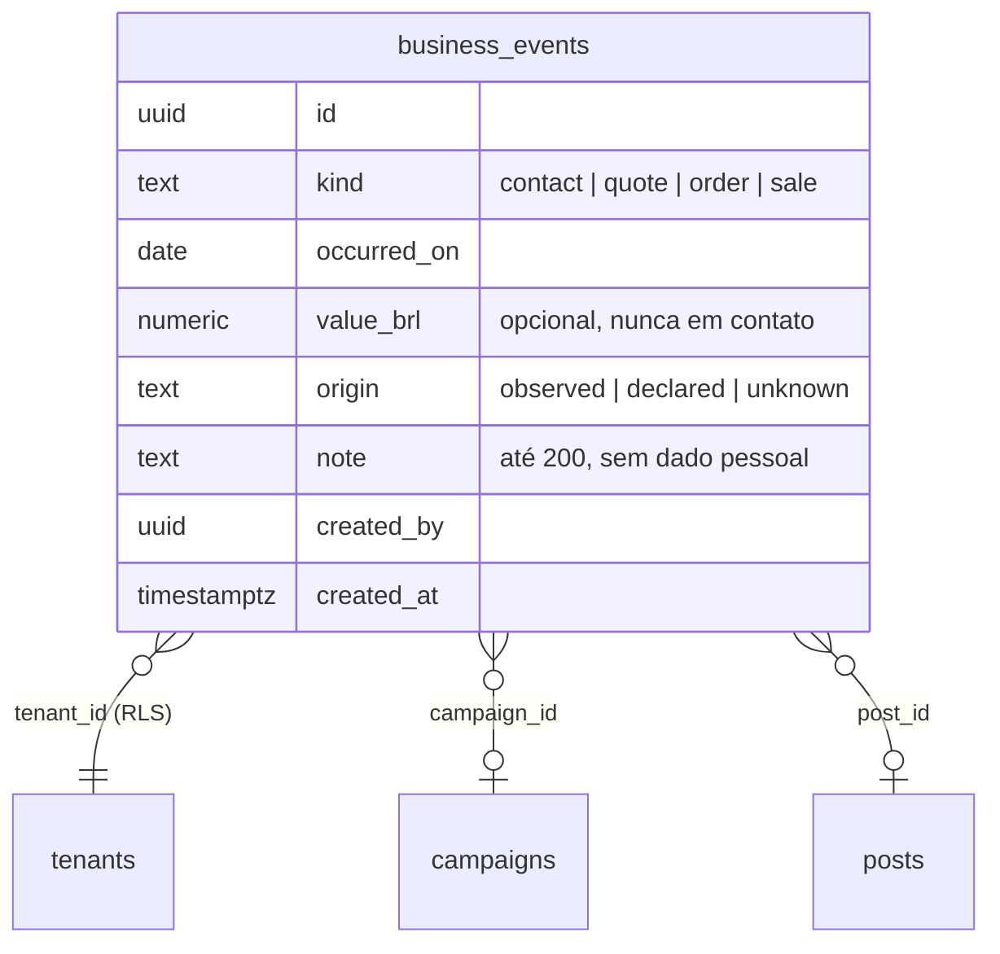

# SPEC 038: resultados comerciais com origem (observada, declarada ou desconhecida)

- **Status:** rascunho de 04/11/2026; protótipo v32 no Claude Design aguardando aprovação (sem ela não há código de tela)
- **Data:** 2026-11-04
- **Cards:** BEZ-551 (esta spec); pai BEZ-542 (roadmap AI-native); vizinho BEZ-276 (eventos de campanha e fatos no PostHog)
- **Origem:** EKO-19 em [`docs/analises/2026-11-03-documentacao-mestra-ai-native.md`](../analises/2026-11-03-documentacao-mestra-ai-native.md) (seção 15)
- **Depende de:** campanhas (SPEC 018), posts publicados (`posts`), UTM dos agendados (`scheduled_posts.utm`), análise do público (SPEC 022)

## Problema

1. A Ekoai mede curtida, alcance e salvamento, mas não sabe se veio pedido, orçamento ou venda. O plano proíbe chamar curtida de
   lead ou venda posterior de resultado da campanha.
2. Quando a empresa sabe que um cliente veio do Instagram ("vi o post do panetone"), não tem onde registrar. A campanha termina sem
   nenhum sinal de negócio, e a próxima decisão continua só com curtida.
3. Sem dizer de onde vem a certeza, um número registrado vira promessa de atribuição que a Ekoai não tem.

## O que muda para a pessoa

- O detalhe da campanha ganha o cartão **Resultados**: "Registrar resultado" abre um formulário curto (o que aconteceu, quando,
  valor opcional, de onde veio, post opcional). A lista mostra o que foi registrado, e o resumo conta por origem.
- O post em Publicados ganha "Registrar resultado deste post", com o post e a campanha já preenchidos.
- Cada registro diz **de onde vem a certeza**:
  - **Observada:** chegou pelo link do post com o código da Ekoai (a pessoa viu no site, no WhatsApp ou no sistema dela).
  - **Declarada:** o cliente disse que viu no Instagram ou no post.
  - **Não sei:** aconteceu durante a campanha, sem ligação conhecida com um post.
- O resumo nunca soma tudo como "resultado da campanha": mostra as três origens separadas e uma frase fixa: "É o que você registrou.
  A Ekoai não sabe sozinha se a venda veio do post."

## Decisões propostas (o Matheus confirma no protótipo)

1. **Registro manual na v1**, como o plano aceita para o piloto. Integração com CRM, loja ou WhatsApp fica para depois.
2. **Tipos:** contato, orçamento, pedido e venda. Valor em reais só para orçamento, pedido e venda, opcional.
3. **Origem:** `observed`, `declared` ou `unknown`, sempre escolhida pela pessoa, sem padrão marcado.
4. **Sem dado pessoal:** nada de nome, telefone ou e-mail do cliente. A observação tem até 200 caracteres e a tela avisa.
5. **Quem registra:** quem cria post ou gerencia a marca. Quem só acompanha vê o cartão, sem o botão.
6. **Apagar:** quem registrou ou quem gerencia a marca apaga um registro errado (fica na auditoria, sem o texto).
7. **Evento:** `business_event_recorded` no PostHog com tipo e origem, sem valor nem texto.

## Protótipo (obrigatório antes de codar)

Versão 32 (`version_id` 1793796020-8b23) do artifact único da Ekoai, https://claude.ai/artifact/55avs7vhgtwKFn9HMAR9Fz, grupo
"Fase 16: resultados com origem (SPEC 038)". Telas, em desktop e celular:

- **Campanha: resultados:** com resultados (resumo por origem), sem resultados, registrando, falha ao salvar e carregando.
- **Publicado: registrar resultado do post:** formulário com o post e registrado.

Fonte em `.context/proto-037` do workspace (`phase15.js`, `phase15.css`, `build.py` sobre a v31). Aguarda a aprovação do Matheus.

## Modelo de dados

Restrições: data de hoje ou antes, até 1 ano atrás; `value_brl` entre 0 e 10 milhões; tabela com RLS e em `TENANT_TABLES`.

## Fora de escopo

Atribuição automática, ROI, comparação entre campanhas por venda e importação de planilha.

## Aceite

- Registrar pelo detalhe da campanha e pelo post publicado; a lista e o resumo mostram as três origens separadas.
- Origem obrigatória; contato sem valor; data futura recusada; nada de dado pessoal no texto da tela.
- Quem só acompanha vê e não registra.
- Evento sem valor nem texto.
- Protótipo aprovado antes do código de tela (desktop e celular; vazio, carregando, erro e cheio).
