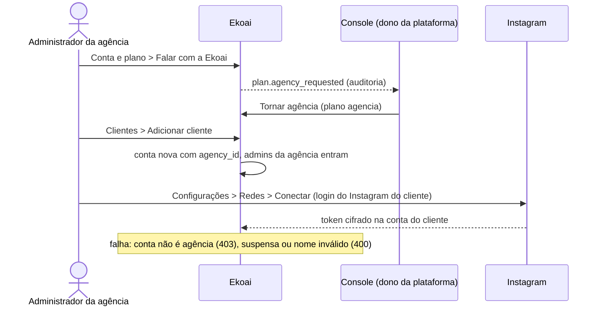

# SPEC 039: agência com clientes, cada um com a própria marca e Instagram

- **Status:** implementado (migration 0067); sem protótipo no Claude Design, telas feitas com os componentes que já existem
- **Data:** 2026-11-09
- **Cards:** BEZ-265 (modelo de agência); vizinhos BEZ-301 (cobrança real, adiada) e BEZ-43 (`PLATFORM_ADMIN_EMAIL` em produção)
- **Decisão:** [ADR 0032](../adr/0032-agencia-como-grupo-de-contas.md), que responde à pergunta 7 da [SPEC 021](021-planos-e-cobranca-por-consumo.md)
- **Depende de:** login por pessoa e várias contas por pessoa (ADR 0005, SPEC 009), console (BEZ-303), conexão do Instagram (SPEC 011 R5)

## Problema

1. Uma agência atende vários clientes, cada um com o próprio Instagram. Na Ekoai, cada conta guarda uma marca só (perfil, fatos,
   regras, agenda, métricas) e publica num Instagram só (`instagramCredentials` pega uma conexão; o banco limita a 1).
2. O botão "Falar com a Ekoai" do plano Agência só gravava o pedido na auditoria. Ninguém via o pedido, e não havia o que ligar.
3. Quem participa de várias contas não tinha como trocar de conta pela tela: a rota `POST /api/auth/tenant` existia sem botão.

## O que muda para a pessoa

- **Console › Contas:** o cartão **Pedidos de Agência** lista os pedidos ainda não atendidos. No detalhe da conta, o cartão
  **Agência** tem **Tornar agência** e, depois, a lista de clientes com o Instagram de cada um.
- **Clientes** (novo item do menu, só na conta da agência e só para o administrador): a lista de clientes com o estado do
  Instagram, **Adicionar cliente** e **Abrir** ou **Conectar Instagram** em cada um. Criar um cliente já abre a conta dele em
  Configurações › Redes.
- **Seletor de conta:** o nome da conta no topo do menu abre a lista das contas da pessoa: a agência, os clientes logo abaixo e
  as outras contas no fim. No celular, a mesma lista fica no "Mais". O menu diz "Plano Agência" ou "Cliente de <agência>".
- **Conta e plano:** a agência vê "Plano Agência" e "Ver clientes"; o cliente vê que o plano e a cobrança são da agência.
- **Sem limite de clientes.** A cobrança por marca (SPEC 021) ainda não está ativa; a tela diz que nada é cobrado agora.

## Regras

1. Cada cliente é uma conta (`tenants`) com `agency_id` apontando para a agência. Isolamento, tokens, marca e publicação são os da
   conta, sem mudança.
2. A agência está no plano `agencia`, que só o console liga. Ela não é cliente de ninguém, e cliente não vira agência (um nível só).
3. A agência só sai do plano sem clientes (o banco recusa).
4. Os administradores da agência entram como administradores de cada cliente novo. Os outros papéis da agência não entram; o
   cliente convida quem quiser pela Equipe, como qualquer conta.
5. O mesmo Instagram não fica em dois clientes (índice único que já existia em `social_accounts`).
6. Cadastrar cliente exige `billing.manage` na conta da agência; ligar o plano exige o portão do console.

## Fluxo

## Fora desta entrega

- Cobrança por marca e saldo de créditos único da agência (SPEC 021, BEZ-301).
- Tela única da agência com aprovação e agenda de todos os clientes juntos.
- Mover uma conta que já existe para dentro da agência (hoje só pelo banco).
- Enquanto a Meta não aprovar o acesso avançado (docs/arquitetura/meta-app-review.md), só Instagram com papel de testador no app
  conecta. Isso vale para os clientes da agência também.
